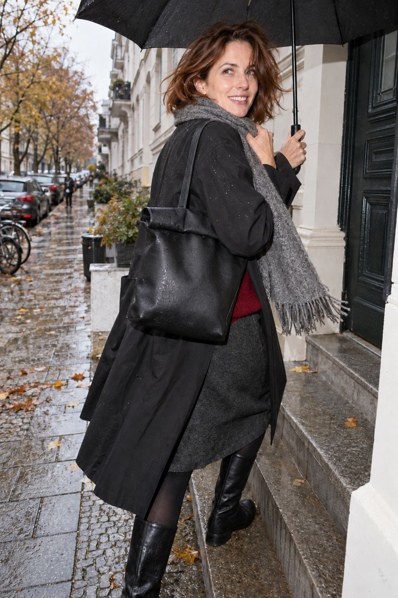

# 05 - A CHERRY NOTE ON THE STEPS

블랙 롱코트에 체리 레드 니트. 울 스커트와 부츠로 이어지는 따뜻한 레이어.

베를린 가을 낮 · Light Rain · 기온 12°C / 체감 7°C · Chilly · 여성 35+ 타깃 · 모델 외관 30세 전후.

촬영: 어깨 높이 뒤쪽 3/4 앵글, 계단을 오르며 돌아보는 모습과 머플러·가방의 겹침. 강한 카메라 직광 플래시.

## 제품 8종

| ID | 품목 | 제품 이미지 | 복원 근거 |
| --- | --- | --- | --- |
| 01-outer | 블랙 롱 레인코트 | [products/01-outer.jpg](products/01-outer.jpg) | 최종 컷에서 확인, 가려진 구조 추정 복원 |
| 02-top | 체리 레드 모헤어 니트 | [products/02-top.jpg](products/02-top.jpg) | 최종 컷에 일부만 보임, 전체 형태 추정 복원 |
| 03-bottom | 차콜 울 미디스커트 | [products/03-bottom.jpg](products/03-bottom.jpg) | 최종 컷에서 확인, 가려진 구조 추정 복원 |
| 04-hosiery | 블랙 불투명 타이츠 | [products/04-hosiery.jpg](products/04-hosiery.jpg) | 최종 컷에 일부만 보임, 전체 형태 추정 복원 |
| 05-shoes | 블랙 니하이 부츠 | [products/05-shoes.jpg](products/05-shoes.jpg) | 최종 컷에서 확인, 가려진 구조 추정 복원 |
| 06-bag | 블랙 롤톱 토트백 | [products/06-bag.jpg](products/06-bag.jpg) | 최종 컷에서 확인, 가려진 구조 추정 복원 |
| 07-scarf | 그레이 울 머플러 | [products/07-scarf.jpg](products/07-scarf.jpg) | 최종 컷에서 확인, 가려진 구조 추정 복원 |
| 08-umbrella | 블랙 우산 | [products/08-umbrella.jpg](products/08-umbrella.jpg) | 최종 컷에서 확인, 가려진 구조 추정 복원 |

에디토리얼은 자유로운 크롭을 유지하고 제품은 전체 형태가 보이는 독립 이미지로 제작했다. 신발·양말·이어링은 한 쌍을 한 품목으로 센다. 양말은 보이지 않는 스타일링 추정이다. 소재명과 방수 표현은 AI 콘셉트이며 실제 상품 사양이 아니다. 브랜드·가격·구매 링크·혼용률은 null. 우산은 제품 컷에서 접힌 상태로 정돈했다. 03의 열쇠·키링은 촬영 소품으로 제품에서 제외했다. 01의 체인 목걸이와 04의 후프 이어링은 각각 독립된 제품 파일이다.

제작 완료, 앱 매핑 pending. 기존 앱 코드와 고정 ID는 변경하지 않았다. 매핑 시 products.json의 순서와 backgroundColor, 재구성 근거를 확인한다.
