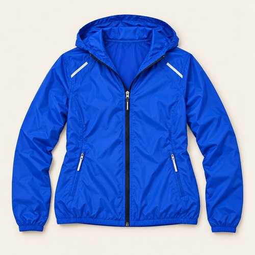
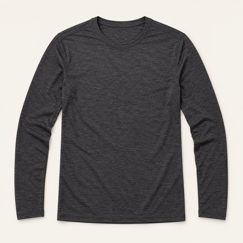
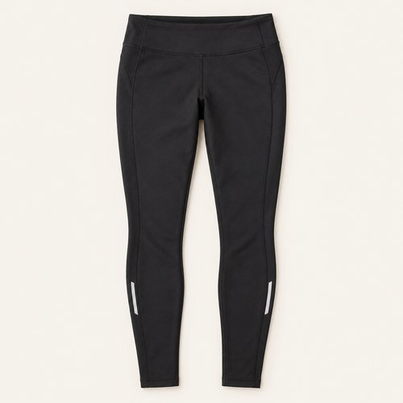
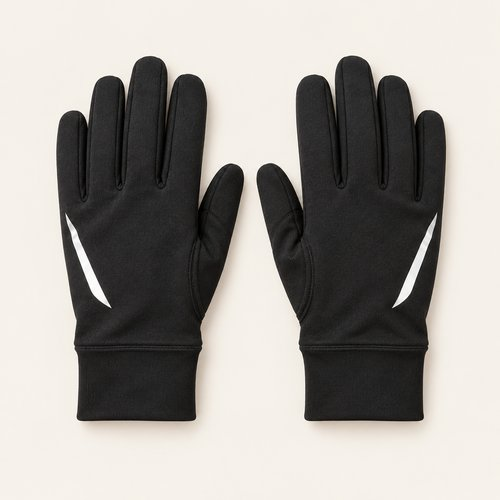
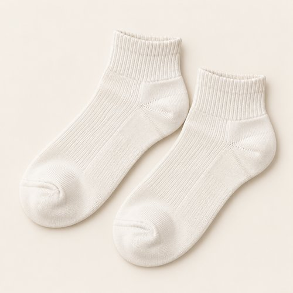
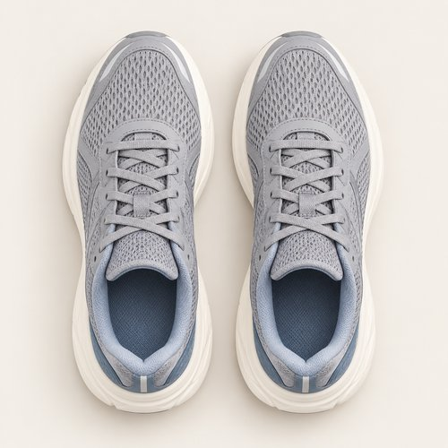
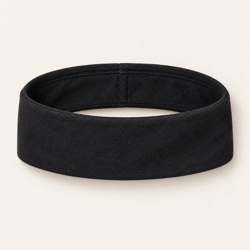

# BLUE IN MOTION

| 언어 | 타이틀 |
| --- | --- |
| 한국어 | 블루 인 모션 |
| English | BLUE IN MOTION |
| Deutsch | BLAU IN BEWEGUNG |

## 세트 정보

- Sunny / Chilly / Female / 35+ / Day / Running / 01
- 기존 앱 룩 ID: `bd15-01-run-f` - 매핑 시 유지
- 구성: 에디토리얼 1장 + 제품별 7장
- 정확한 기온·체감온도 수치: 확인되지 않음. 폴더 기준 체감 단계는 Chilly.
- 2026-10-22 사용자 요청으로 업로드. 앱 매핑 상태: pending.

## Editorial

기존 `../01-running.jpg`에서 앱용 JPG로 압축한 사본. 원본 경로는 유지.

## How to wear

### 한국어

코발트 셸 하나, 나머지는 차콜과 블랙.

선명한 블루 셸에 차콜 크루넥과 블랙 타이츠를 겹쳐요. 헤드밴드와 장갑은 블랙으로 연결하고, 아이보리 삭스와 그레이 러너로 발끝만 밝게 마무리해요.

### English

One cobalt shell. Everything else in charcoal and black.

Layer a vivid blue shell over a charcoal crew neck and black tights. Keep headband and gloves black, then lighten the finish with ivory socks and grey runners.

### Deutsch

Eine kobaltblaue Jacke. Dazu Anthrazit und Schwarz.

Kombiniere eine kräftig blaue Jacke mit einem anthrazitfarbenen Rundhalsshirt und schwarzen Tights. Stirnband und Handschuhe bleiben schwarz; elfenbeinfarbene Socken und graue Laufschuhe setzen einen hellen Abschluss.

## The pieces

| 파일 | 한국어 | English | Deutsch |
| --- | --- | --- | --- |
| [01-outer](products/01-outer.jpg) | 코발트 러닝 셸 | Cobalt Running Shell | Kobaltblaue Laufjacke |
| [02-top](products/02-top.jpg) | 차콜 러닝 롱슬리브 | Charcoal Running Long Sleeve | Anthrazitfarbenes Laufshirt |
| [03-bottom](products/03-bottom.jpg) | 블랙 러닝 타이츠 | Black Running Tights | Schwarze Lauftights |
| [04-hands](products/04-hands.jpg) | 블랙 러닝 글러브 | Black Running Gloves | Schwarze Laufhandschuhe |
| [05-socks](products/05-socks.jpg) | 아이보리 앵클 삭스 | Ivory Ankle Socks | Elfenbeinfarbene Knöchelsocken |
| [06-shoes](products/06-shoes.jpg) | 그레이 메쉬 러너 | Grey Mesh Runners | Graue Mesh-Laufschuhe |
| [07-headwear](products/07-headwear.jpg) | 블랙 러닝 헤드밴드 | Black Running Headband | Schwarzes Laufstirnband |

### 01-outer · Cobalt Running Shell

- KO: 코발트 블루 셸을 차콜 이너 위에 걸쳐 색의 중심을 잡아요. 지퍼를 조금 열어 안쪽 레이어를 보여주세요.
- EN: Wear the cobalt shell over charcoal and leave the zip slightly open to reveal the layer beneath.
- DE: Trage die kobaltblaue Jacke über Anthrazit und öffne den Reißverschluss leicht, damit die Lage darunter sichtbar wird.
- 복원 구분: `visible-item-reconstructed`

### 02-top · Charcoal Running Long Sleeve

- KO: 차콜 크루넥으로 블루의 선명함을 받쳐요. 재킷 아래에서 원단이 뭉치지 않게 매끈하게 정리해요.
- EN: A charcoal crew neck grounds the vivid blue. Keep the layer smooth beneath the jacket.
- DE: Ein anthrazitfarbenes Rundhalsshirt erdet das kräftige Blau. Ziehe die Lage unter der Jacke glatt.
- 복원 구분: `partially-visible-reconstructed`

### 03-bottom · Black Running Tights

- KO: 블랙 타이츠로 하체의 실루엣을 간결하게 이어가요. 밑단은 발목에 정리하고 밝은 양말을 짧게 드러내요.
- EN: Keep the lower half streamlined with black tights and let a short section of pale sock show at the ankle.
- DE: Halte die Silhouette mit schwarzen Tights klar und lasse am Knöchel einen schmalen Streifen der hellen Socken sichtbar.
- 복원 구분: `partially-visible-reconstructed`

### 04-hands · Black Running Gloves

- KO: 블랙 글러브를 타이츠와 연결해 색을 정리해요. 손등의 실버 디테일이 작은 포인트가 돼요.
- EN: Link black gloves to the tights for a controlled palette, with silver details as small accents.
- DE: Schwarze Handschuhe greifen die Farbe der Tights auf. Silberne Details setzen kleine Akzente.
- 복원 구분: `partially-visible-reconstructed`

### 05-socks · Ivory Ankle Socks

- KO: 아이보리 양말을 타이츠와 러닝화 사이에 짧게 보여줘요. 주름을 과하게 쌓지 않고 발목선을 정돈해요.
- EN: Show a short band of ivory between tights and trainers, keeping the ankle neat without bunching.
- DE: Lasse zwischen Tights und Laufschuhen einen kurzen elfenbeinfarbenen Streifen sichtbar und vermeide Falten am Knöchel.
- 복원 구분: `partially-visible-reconstructed`

### 06-shoes · Grey Mesh Runners

- KO: 라이트 그레이 러너로 발끝을 가볍게 마무리해요. 아이보리 양말과 솔의 밝은 톤을 이어주세요.
- EN: Finish with light grey runners, linking their pale soles to the ivory socks.
- DE: Runde den Look mit hellgrauen Laufschuhen ab und verbinde die helle Sohle mit den elfenbeinfarbenen Socken.
- 복원 구분: `partially-visible-reconstructed`

### 07-headwear · Black Running Headband

- KO: 넓은 블랙 헤드밴드로 머리 주변을 정돈해요. 장갑과 타이츠에 맞춰 블루 셸이 돋보이게 해요.
- EN: Frame the face with a wide black headband, matching gloves and tights so the blue shell stands out.
- DE: Ein breites schwarzes Stirnband rahmt das Gesicht und passt zu Handschuhen und Tights, sodass die blaue Jacke hervorsticht.
- 복원 구분: `visible-item-reconstructed`

## 제작·인수인계 메모

- 모든 제품 컷은 AI로 재구성한 스타일링 콘셉트 이미지. 실제 판매 상품 정보가 아님.
- 이너의 긴 소매·가려진 몸판, 타이츠 허리, 장갑 손가락·손바닥, 양말 발 부분, 신발 반대쪽·가려진 구조는 추정 복원. 원본에서 확인한 디테일과 구분할 것.
- 브랜드·가격·구매 링크·소재 혼용률·성능 수치는 확인되지 않아 null.
- 에디토리얼: 1024×1536 JPG ≤300KB. 제품: 각 500×500 JPG ≤50KB.
- 앱용 문구에는 날씨 수치를 넣지 않음. 날씨 메타데이터는 products.json으로 분리.
- 앱 매핑 시 기존 룩 ID와 기존 에디토리얼 경로를 유지하고, products.json의 7개 아이템을 연결할 것.
- 이미지 생성 프롬프트는 PROMPTS.md 참고.
