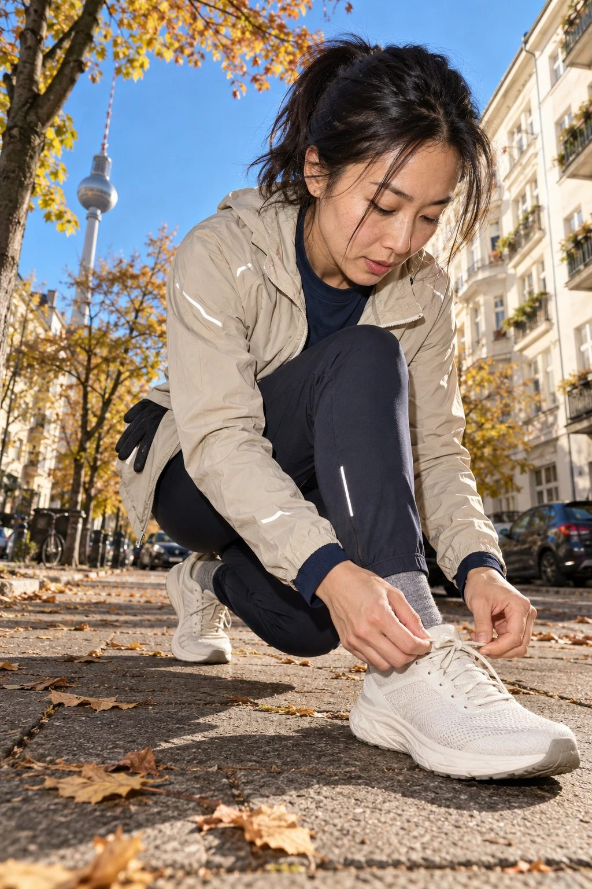
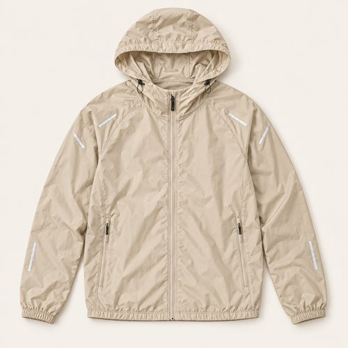
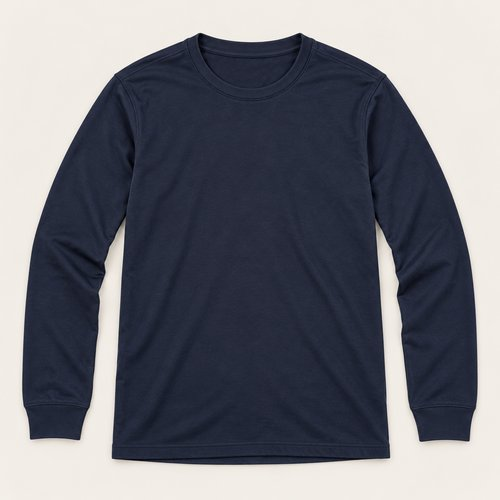
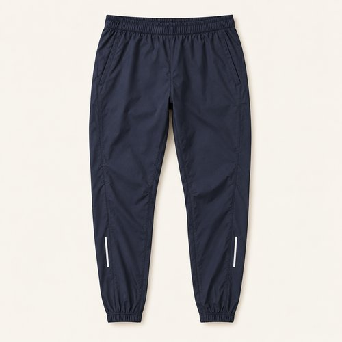
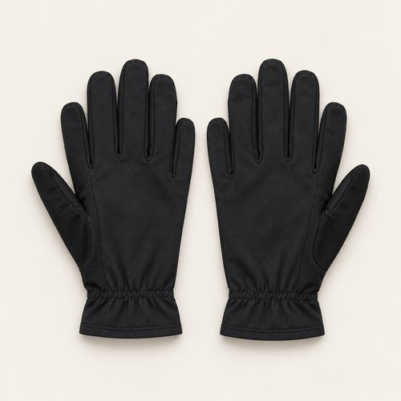
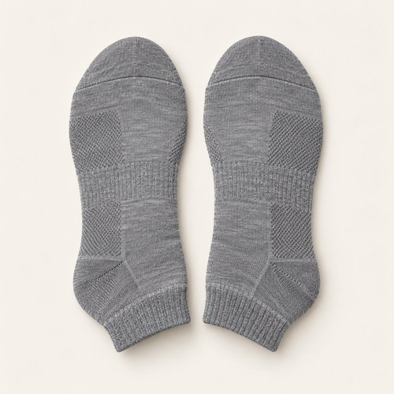
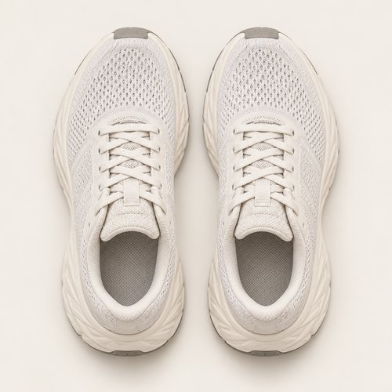

# SOFT START

| 언어 | 타이틀 |
| --- | --- |
| 한국어 | 소프트 스타트 |
| English | SOFT START |
| Deutsch | SANFTER START |

## 세트 정보

- Sunny / Chilly / Female / 35+ / Day / Running / 02
- 기존 앱 ID: `bd15-02-run-f` - 매핑 시 유지
- 에디토리얼 1장 + 제품별 6장
- 정확한 기온·체감온도 수치: 확인되지 않음. 폴더 기준 체감 단계: Chilly.
- 사용자 요청으로 브레이크다운 제작 및 업로드. 앱 매핑 상태: pending.

## Editorial

기존 `../02-running.jpg`의 앱용 압축 사본. 원본 경로 유지.

## How to wear

### 한국어

샌드와 네이비, 출발을 가볍게.

샌드 셸 아래 짙은 네이비를 길게 이어줘요. 여유 있는 러닝 팬츠의 밑단을 정돈하고, 그레이 삭스와 밝은 메쉬 러너로 발끝을 가볍게 마무리해요.

### English

Sand and navy. An easy start.

Run dark navy beneath a sand shell. Keep the tapered trousers neat at the ankle, then finish with grey socks and pale mesh runners.

### Deutsch

Sand und Marineblau. Ein entspannter Start.

Kombiniere eine sandfarbene Jacke mit dunklem Marineblau. Halte die schmal zulaufende Hose am Knöchel ordentlich und ergänze graue Socken sowie helle Mesh-Laufschuhe.

## The pieces

| 파일 | 한국어 | English | Deutsch |
| --- | --- | --- | --- |
| [01-outer](products/01-outer.jpg) | 샌드 러닝 셸 | Sand Running Shell | Sandfarbene Laufjacke |
| [02-top](products/02-top.jpg) | 네이비 러닝 롱슬리브 | Navy Running Long Sleeve | Marineblaues Laufshirt |
| [03-bottom](products/03-bottom.jpg) | 잉크 러닝 팬츠 | Ink Running Pants | Dunkelblaue Laufhose |
| [04-hands](products/04-hands.jpg) | 블랙 러닝 글러브 | Black Running Gloves | Schwarze Laufhandschuhe |
| [05-socks](products/05-socks.jpg) | 그레이 앵클 삭스 | Grey Ankle Socks | Graue Knöchelsocken |
| [06-shoes](products/06-shoes.jpg) | 오프화이트 메쉬 러너 | Off-White Mesh Runners | Offwhite-Mesh-Laufschuhe |

### 01-outer · Sand Running Shell

- KO: 밝은 샌드 셸을 네이비 위에 열어 입어요. 어두운 이너가 앞면을 세로로 정리해요.
- EN: Wear the sand shell open over navy, letting the dark inner layer create a clean vertical line.
- DE: Trage die sandfarbene Jacke offen über Marineblau; die dunkle Lage bildet eine klare vertikale Linie.
- 복원 구분: `visible-item-reconstructed`

### 02-top · Navy Running Long Sleeve

- KO: 네이비 크루넥을 팬츠와 이어 한 톤처럼 보여줘요. 소매 끝만 셸 밖으로 짧게 드러내요.
- EN: Link the navy crew neck to the trousers and let just a little cuff show beyond the shell.
- DE: Verbinde das marineblaue Rundhalsshirt farblich mit der Hose und lasse nur etwas Bündchen unter der Jacke hervorschauen.
- 복원 구분: `partially-visible-reconstructed`

### 03-bottom · Ink Running Pants

- KO: 타이츠 대신 여유 있는 테이퍼드 핏으로 가요. 밑단을 발목 위에 정리해 신발의 형태를 드러내요.
- EN: Choose a relaxed taper instead of tights and keep the hems neat above the shoes.
- DE: Wähle statt Tights eine lockere, schmal zulaufende Hose und ordne den Saum oberhalb der Schuhe.
- 복원 구분: `partially-visible-reconstructed`

### 04-hands · Black Running Gloves

- KO: 블랙 글러브는 네이비와 자연스럽게 연결해요. 벗었을 때는 셸 포켓에 정리해요.
- EN: Black gloves blend into the navy palette; tuck them into a shell pocket when removed.
- DE: Schwarze Handschuhe fügen sich in die dunkle Palette ein; verstaue sie nach dem Ausziehen in einer Jackentasche.
- 복원 구분: `partially-visible-reconstructed`

### 05-socks · Grey Ankle Socks

- KO: 그레이 삭스를 팬츠와 밝은 러너 사이에 조금 보여줘요. 발목에 원단이 뭉치지 않게 정리해요.
- EN: Let grey socks bridge the dark trousers and pale runners without bunching at the ankle.
- DE: Graue Socken verbinden die dunkle Hose mit den hellen Laufschuhen, ohne sich am Knöchel zu stauen.
- 복원 구분: `partially-visible-reconstructed`

### 06-shoes · Off-White Mesh Runners

- KO: 오프화이트 메쉬 러너로 전체 톤을 가볍게 끝내요. 끈은 갑피 위에 가지런히 정리해요.
- EN: Finish the muted palette with off-white mesh runners and keep the laces tidy.
- DE: Runde die gedeckte Palette mit Offwhite-Mesh-Laufschuhen ab und binde die Schnürsenkel ordentlich.
- 복원 구분: `partially-visible-reconstructed`

## 제작·인수인계 메모

- AI로 재구성한 스타일링 콘셉트 제품 이미지. 실제 판매 상품 정보가 아님.
- 가려진 뒷면·허리·신발 반대쪽·내부 구조는 추정 복원. 브랜드·가격·소재 혼용률·성능은 확인되지 않아 null.
- 에디토리얼 1024×1536 JPG ≤300KB. 제품별 500×500 JPG ≤50KB.
- 한 쌍의 신발·양말·장갑·귀걸이는 각각 하나의 아이템.
- 앱용 카피에는 날씨 정보를 넣지 않고 메타데이터와 분리.
- 앱 매핑 시 기존 ID·에디토리얼 경로 보존. 이 업로드는 앱 등록 작업과 별개.

- 장갑은 허리 옆에 끼운 검은 장갑을 바탕으로 추정 복원. 이너 소매의 가려진 부분도 추정.
