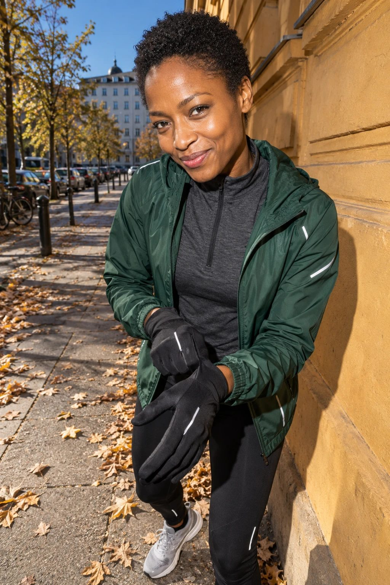
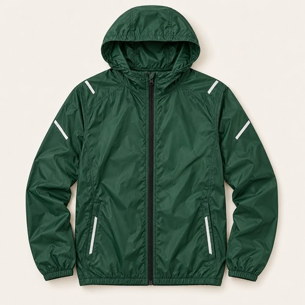
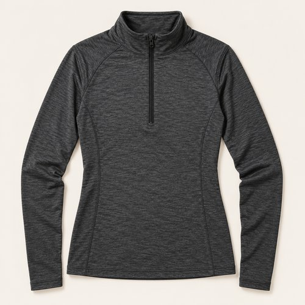
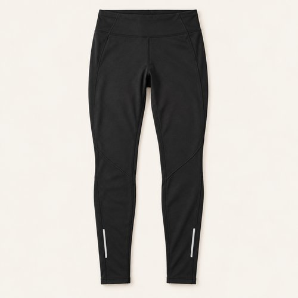
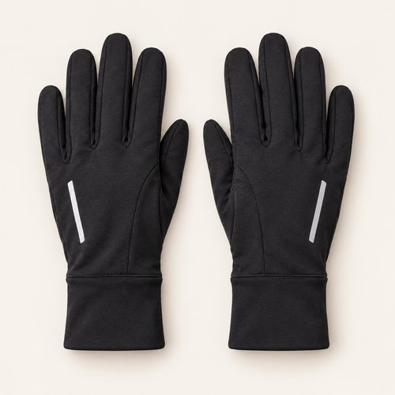
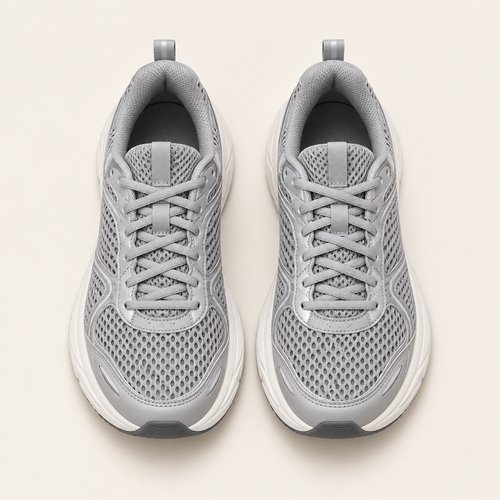

# FOREST PACE

| 언어 | 타이틀 |
| --- | --- |
| 한국어 | 포레스트 페이스 |
| English | FOREST PACE |
| Deutsch | TEMPO IN WALDGRÜN |

## 세트 정보

- Sunny / Chilly / Female / 35+ / Day / Running / 03
- 기존 앱 ID: `bd15-03-run-f` - 매핑 시 유지
- 에디토리얼 1장 + 제품별 5장
- 정확한 기온·체감온도 수치: 확인되지 않음. 폴더 기준 체감 단계: Chilly.
- 사용자 요청으로 브레이크다운 제작 및 업로드. 앱 매핑 상태: pending.

## Editorial

기존 `../03-running.jpg`의 앱용 압축 사본. 원본 경로 유지.

## How to wear

### 한국어

포레스트 그린 위로, 차콜과 블랙의 리듬.

딥 그린 셸을 열어 차콜 하프집의 짧은 지퍼 라인을 보여줘요. 블랙 타이츠와 글러브로 실루엣을 정리하고 그레이 러너로 밝기를 조금 더해요.

### English

Forest green, grounded in charcoal and black.

Open the deep green shell to reveal the charcoal half-zip. Black tights and gloves keep the silhouette controlled, while grey runners add a lighter finish.

### Deutsch

Waldgrün, geerdet durch Anthrazit und Schwarz.

Öffne die tiefgrüne Jacke, damit der kurze Reißverschluss des anthrazitfarbenen Shirts sichtbar wird. Schwarze Tights und Handschuhe halten den Look klar; graue Laufschuhe hellen ihn auf.

## The pieces

| 파일 | 한국어 | English | Deutsch |
| --- | --- | --- | --- |
| [01-outer](products/01-outer.jpg) | 포레스트 러닝 셸 | Forest Running Shell | Waldgrüne Laufjacke |
| [02-top](products/02-top.jpg) | 차콜 하프집 롱슬리브 | Charcoal Half-Zip Long Sleeve | Anthrazitfarbenes Half-Zip-Shirt |
| [03-bottom](products/03-bottom.jpg) | 블랙 러닝 타이츠 | Black Running Tights | Schwarze Lauftights |
| [04-hands](products/04-hands.jpg) | 차콜 러닝 글러브 | Charcoal Running Gloves | Anthrazitfarbene Laufhandschuhe |
| [05-shoes](products/05-shoes.jpg) | 그레이 메쉬 러너 | Grey Mesh Runners | Graue Mesh-Laufschuhe |

### 01-outer · Forest Running Shell

- KO: 포레스트 그린 셸을 열어 차콜 이너를 보여줘요. 반사 라인은 색을 더하지 않는 작은 디테일이에요.
- EN: Open the forest shell to show charcoal beneath; silver lines add detail without another colour.
- DE: Öffne die waldgrüne Jacke über Anthrazit; silberne Linien ergänzen Details ohne eine weitere Farbe.
- 복원 구분: `visible-item-reconstructed`

### 02-top · Charcoal Half-Zip Long Sleeve

- KO: 하프집의 스탠드 칼라를 셸 안쪽에 정리해요. 짧은 검은 지퍼가 중심선을 만들어요.
- EN: Set the half-zip collar neatly inside the shell and use its short black zip as a central line.
- DE: Ordne den Stehkragen innerhalb der Jacke; der kurze schwarze Reißverschluss bildet die Mittellinie.
- 복원 구분: `partially-visible-reconstructed`

### 03-bottom · Black Running Tights

- KO: 블랙 타이츠로 딥 그린과 차콜을 간결하게 받쳐요. 무릎과 밑단의 원단을 매끈하게 정리해요.
- EN: Ground green and charcoal with black tights, smoothing the fabric at knees and hems.
- DE: Erde Grün und Anthrazit mit schwarzen Tights und streiche den Stoff an Knien und Säumen glatt.
- 복원 구분: `partially-visible-reconstructed`

### 04-hands · Charcoal Running Gloves

- KO: 차콜 글러브를 이너와 맞춰요. 커프를 셸 소매 안쪽에 넣어 손목선을 정돈해요.
- EN: Match charcoal gloves to the inner layer and tuck their cuffs inside the shell sleeves.
- DE: Stimme anthrazitfarbene Handschuhe auf die innere Lage ab und stecke ihre Bündchen unter die Jackenärmel.
- 복원 구분: `partially-visible-reconstructed`

### 05-shoes · Grey Mesh Runners

- KO: 밝은 그레이 러너로 어두운 착장 아래에 가벼운 면을 만들어요. 실버 패널과 셸의 작은 라인을 연결해요.
- EN: Light grey runners lift the dark outfit and echo the small silver lines on the shell.
- DE: Hellgraue Laufschuhe lockern den dunklen Look auf und greifen die silbernen Linien der Jacke auf.
- 복원 구분: `partially-visible-reconstructed`

## 제작·인수인계 메모

- AI로 재구성한 스타일링 콘셉트 제품 이미지. 실제 판매 상품 정보가 아님.
- 가려진 뒷면·허리·신발 반대쪽·내부 구조는 추정 복원. 브랜드·가격·소재 혼용률·성능은 확인되지 않아 null.
- 에디토리얼 1024×1536 JPG ≤300KB. 제품별 500×500 JPG ≤50KB.
- 한 쌍의 신발·양말·장갑·귀걸이는 각각 하나의 아이템.
- 앱용 카피에는 날씨 정보를 넣지 않고 메타데이터와 분리.
- 앱 매핑 시 기존 ID·에디토리얼 경로 보존. 이 업로드는 앱 등록 작업과 별개.

- 양말은 원본에서 명확히 확인되지 않아 추가하지 않음.
