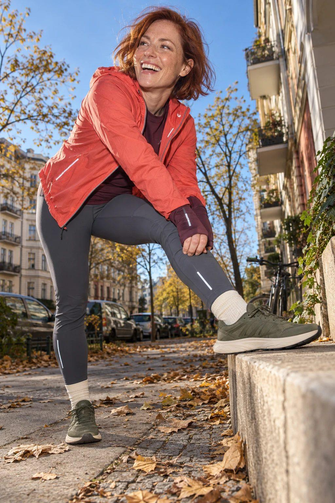
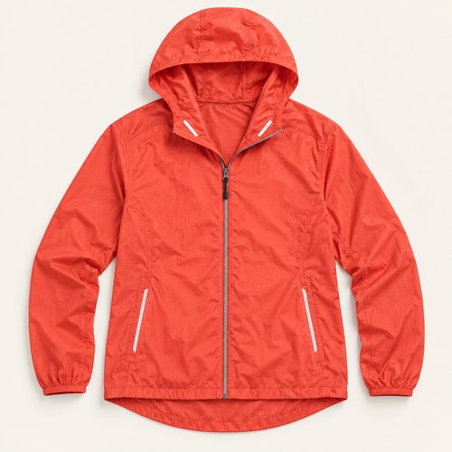
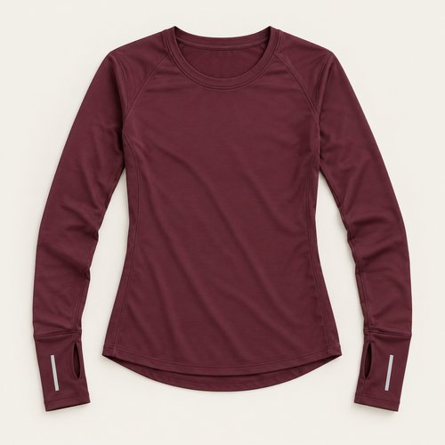
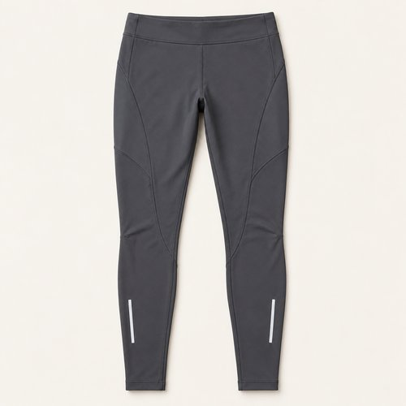
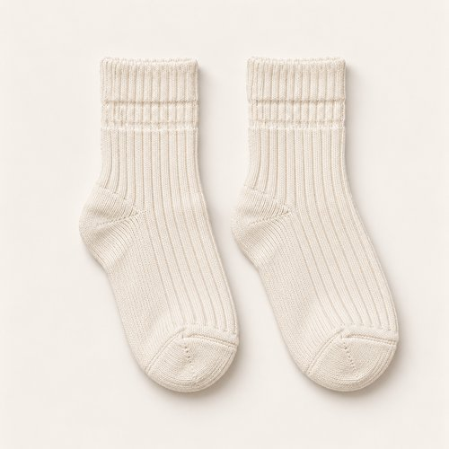
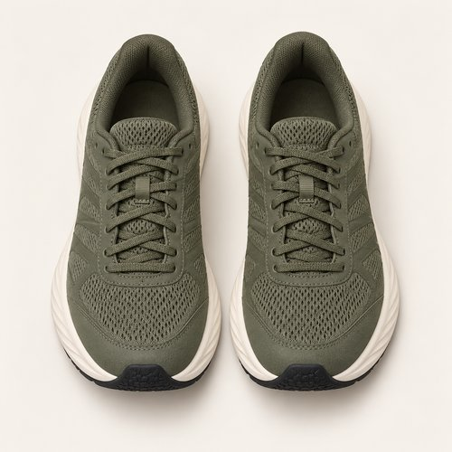

# CORAL STRIDE

| 언어 | 타이틀 |
| --- | --- |
| 한국어 | 코랄 스트라이드 |
| English | CORAL STRIDE |
| Deutsch | SCHRITTE IN KORALLE |

## 세트 정보

- Sunny / Chilly / Female / 35+ / Day / Running / 04
- 기존 앱 ID: `bd15-04-run-f` - 매핑 시 유지
- 에디토리얼 1장 + 제품별 5장
- 정확한 기온·체감온도 수치: 확인되지 않음. 폴더 기준 체감 단계: Chilly.
- 사용자 요청으로 브레이크다운 제작 및 업로드. 앱 매핑 상태: pending.

## Editorial

기존 `../04-running.jpg`의 앱용 압축 사본. 원본 경로 유지.

## How to wear

### 한국어

코랄과 버건디, 올리브로 마무리하는 한 걸음.

코랄 셸과 버건디 이너를 겹쳐 따뜻한 색의 깊이를 만들어요. 긴 커프를 소매 밖으로 드러내고, 슬레이트 타이츠와 아이보리 삭스 사이에 올리브 러너를 더해요.

### English

Coral over burgundy, finished in olive.

Layer coral over burgundy for depth within a warm palette. Let the long cuffs extend past the shell sleeves, then add slate tights, ivory socks and olive runners.

### Deutsch

Koralle über Burgunder, abgerundet mit Oliv.

Schichte Koralle über Burgunder für Tiefe in einer warmen Farbpalette. Lasse die langen Bündchen unter der Jacke hervorschauen und ergänze schiefergraue Tights, elfenbeinfarbene Socken und olivgrüne Laufschuhe.

## The pieces

| 파일 | 한국어 | English | Deutsch |
| --- | --- | --- | --- |
| [01-outer](products/01-outer.jpg) | 코랄 러닝 셸 | Coral Running Shell | Korallfarbene Laufjacke |
| [02-top](products/02-top.jpg) | 버건디 커프 롱슬리브 | Burgundy Cuff Long Sleeve | Burgunderfarbenes Shirt mit langen Bündchen |
| [03-bottom](products/03-bottom.jpg) | 슬레이트 러닝 타이츠 | Slate Running Tights | Schiefergraue Lauftights |
| [04-socks](products/04-socks.jpg) | 아이보리 리브 삭스 | Ivory Rib Socks | Elfenbeinfarbene Rippensocken |
| [05-shoes](products/05-shoes.jpg) | 올리브 메쉬 러너 | Olive Mesh Runners | Olivgrüne Mesh-Laufschuhe |

### 01-outer · Coral Running Shell

- KO: 코랄 셸을 주인공으로 두고 앞을 살짝 열어요. 안쪽 버건디가 밝은 색에 깊이를 더해요.
- EN: Make coral the focal point and open the shell slightly to show the deeper burgundy beneath.
- DE: Setze Koralle in den Mittelpunkt und öffne die Jacke leicht, um das tiefere Burgunder darunter zu zeigen.
- 복원 구분: `visible-item-reconstructed`

### 02-top · Burgundy Cuff Long Sleeve

- KO: 버건디 롱슬리브의 긴 커프를 손등까지 이어줘요. 별도 장갑 대신 소매 디테일을 보여주는 조합이에요.
- EN: Extend the burgundy thumbhole cuffs over the backs of the hands; these are shirt cuffs, not separate gloves.
- DE: Ziehe die langen burgunderfarbenen Daumenlochbündchen über die Handrücken; sie gehören zum Shirt und sind keine separaten Handschuhe.
- 복원 구분: `partially-visible-reconstructed`

### 03-bottom · Slate Running Tights

- KO: 슬레이트 타이츠로 코랄과 버건디의 채도를 받쳐요. 밝은 양말이 보이도록 밑단을 정리해요.
- EN: Let slate tights balance coral and burgundy, keeping the hems neat above the pale socks.
- DE: Schiefergraue Tights gleichen Koralle und Burgunder aus; ordne die Säume oberhalb der hellen Socken.
- 복원 구분: `partially-visible-reconstructed`

### 04-socks · Ivory Rib Socks

- KO: 아이보리 리브 삭스를 발목 위로 드러내요. 올리브 슈즈와 타이츠 사이에 밝은 간격을 만들어요.
- EN: Show ivory rib socks above the ankle for a pale break between slate tights and olive shoes.
- DE: Lasse elfenbeinfarbene Rippensocken über dem Knöchel sichtbar, als helle Unterbrechung zwischen Tights und olivgrünen Schuhen.
- 복원 구분: `partially-visible-reconstructed`

### 05-shoes · Olive Mesh Runners

- KO: 올리브 러너로 따뜻한 상의 색을 차분하게 마무리해요. 크림 솔을 양말과 연결해요.
- EN: Olive runners settle the warm upper layers, with cream soles echoing the socks.
- DE: Olivgrüne Laufschuhe beruhigen die warmen Oberteile; die cremefarbene Sohle greift die Socken auf.
- 복원 구분: `partially-visible-reconstructed`

## 제작·인수인계 메모

- AI로 재구성한 스타일링 콘셉트 제품 이미지. 실제 판매 상품 정보가 아님.
- 가려진 뒷면·허리·신발 반대쪽·내부 구조는 추정 복원. 브랜드·가격·소재 혼용률·성능은 확인되지 않아 null.
- 에디토리얼 1024×1536 JPG ≤300KB. 제품별 500×500 JPG ≤50KB.
- 한 쌍의 신발·양말·장갑·귀걸이는 각각 하나의 아이템.
- 앱용 카피에는 날씨 정보를 넣지 않고 메타데이터와 분리.
- 앱 매핑 시 기존 ID·에디토리얼 경로 보존. 이 업로드는 앱 등록 작업과 별개.

- 손등의 버건디 부분은 이너의 긴 썸홀 커프로 해석했으며 별도 장갑으로 분리하지 않음. 정확한 구조는 추정.
