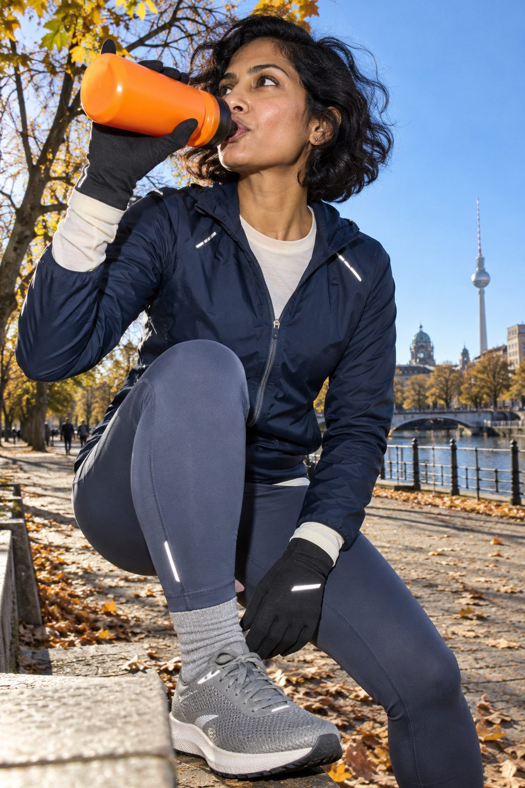
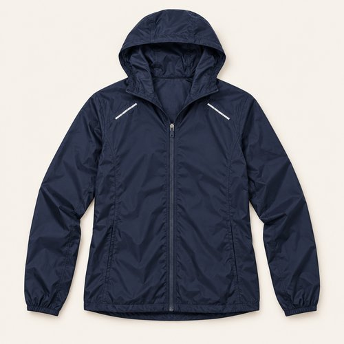
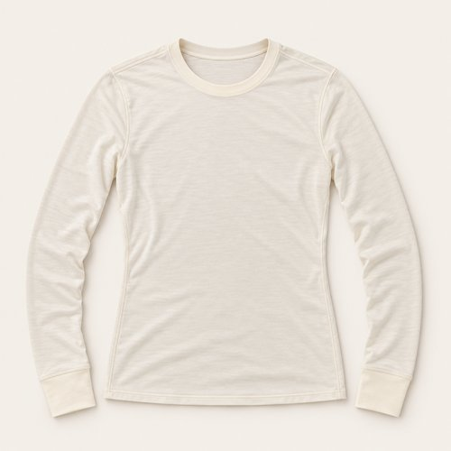
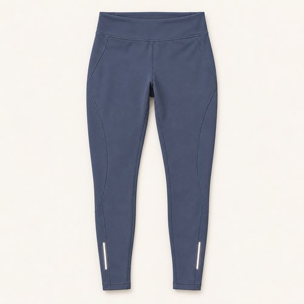
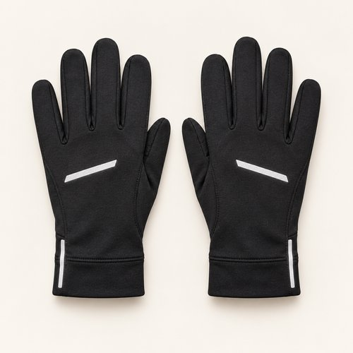
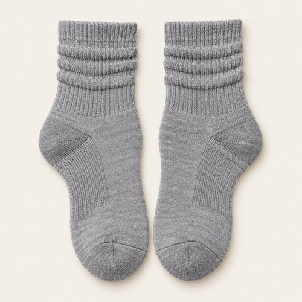
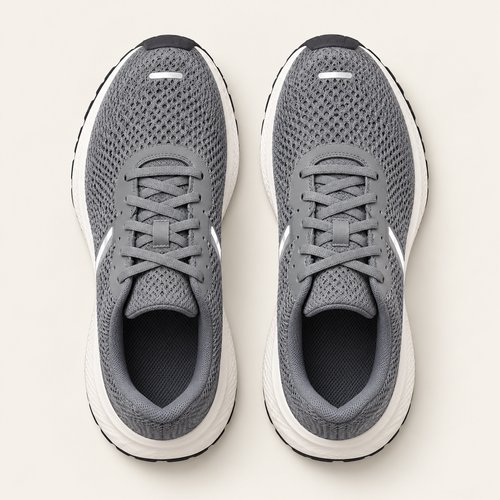
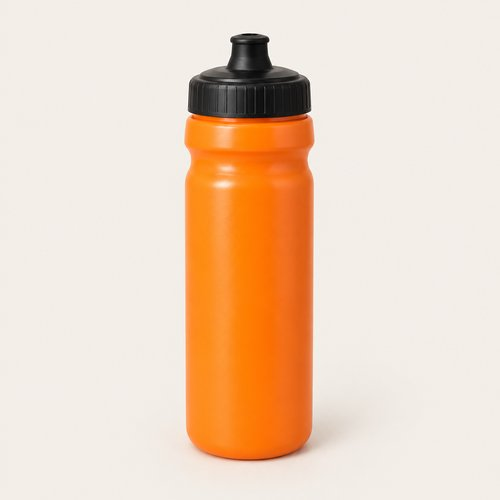
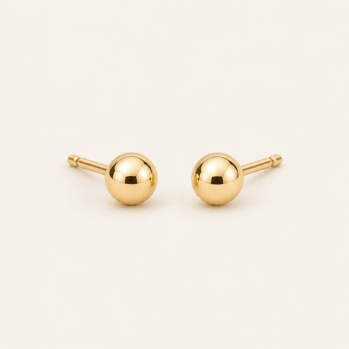

# NAVY, WITH A TWIST

| 언어 | 타이틀 |
| --- | --- |
| 한국어 | 네이비 위드 어 트위스트 |
| English | NAVY, WITH A TWIST |
| Deutsch | MARINEBLAU MIT TWIST |

## 세트 정보

- Sunny / Chilly / Female / 35+ / Day / Running / 05
- 기존 앱 ID: `bd15-05-run-f` - 매핑 시 유지
- 에디토리얼 1장 + 제품별 8장
- 정확한 기온·체감온도 수치: 확인되지 않음. 폴더 기준 체감 단계: Chilly.
- 사용자 요청으로 브레이크다운 제작 및 업로드. 앱 매핑 상태: pending.

## Editorial

기존 `../05-running.jpg`의 앱용 압축 사본. 원본 경로 유지.

## How to wear

### 한국어

네이비의 차분함에 오렌지 한 모금.

네이비 셸과 블루그레이 타이츠를 비슷한 톤으로 연결해요. 아이보리 이너와 그레이 삭스로 틈을 밝히고, 오렌지 보틀과 작은 골드 스터드로 포인트를 더해요.

### English

Calm navy. One bright orange accent.

Link a navy shell to blue-grey tights. Ivory cuffs and grey socks lift the layers, while an orange bottle and tiny gold-tone studs add small accents.

### Deutsch

Ruhiges Marineblau. Ein leuchtend orangefarbener Akzent.

Verbinde eine marineblaue Jacke mit blaugrauen Tights. Elfenbeinfarbene Bündchen und graue Socken lockern die Lagen auf; eine orangefarbene Flasche und kleine goldfarbene Ohrstecker setzen Akzente.

## The pieces

| 파일 | 한국어 | English | Deutsch |
| --- | --- | --- | --- |
| [01-outer](products/01-outer.jpg) | 네이비 러닝 셸 | Navy Running Shell | Marineblaue Laufjacke |
| [02-top](products/02-top.jpg) | 아이보리 러닝 롱슬리브 | Ivory Running Long Sleeve | Elfenbeinfarbenes Laufshirt |
| [03-bottom](products/03-bottom.jpg) | 블루그레이 러닝 타이츠 | Blue-Grey Running Tights | Blaugraue Lauftights |
| [04-hands](products/04-hands.jpg) | 블랙 리플렉티브 글러브 | Black Reflective Gloves | Schwarze Handschuhe mit Reflexdetails |
| [05-socks](products/05-socks.jpg) | 그레이 리브 삭스 | Grey Rib Socks | Graue Rippensocken |
| [06-shoes](products/06-shoes.jpg) | 그레이 니트 러너 | Grey Knit Runners | Graue Knit-Laufschuhe |
| [07-gear](products/07-gear.jpg) | 오렌지 스포츠 보틀 | Orange Sports Bottle | Orange Sportflasche |
| [08-jewelry](products/08-jewelry.jpg) | 미니 골드 스터드 | Mini Gold Studs | Kleine goldfarbene Ohrstecker |

### 01-outer · Navy Running Shell

- KO: 네이비 셸의 지퍼를 열어 아이보리 크루넥을 보여줘요. 어두운 색 안에 밝은 세로 면을 남겨요.
- EN: Open the navy shell over ivory to leave a light vertical panel within the darker outfit.
- DE: Öffne die marineblaue Jacke über Elfenbein und lasse eine helle vertikale Fläche im dunklen Look stehen.
- 복원 구분: `visible-item-reconstructed`

### 02-top · Ivory Running Long Sleeve

- KO: 아이보리 이너의 소매를 셸 밖으로 조금 빼요. 목선과 손목의 밝기를 연결해요.
- EN: Let ivory cuffs extend beyond the shell sleeves, linking light accents at neck and wrists.
- DE: Lasse die elfenbeinfarbenen Bündchen unter den Jackenärmeln hervorschauen und verbinde helle Akzente an Hals und Handgelenken.
- 복원 구분: `partially-visible-reconstructed`

### 03-bottom · Blue-Grey Running Tights

- KO: 블루그레이 타이츠를 네이비 셸과 톤온톤으로 맞춰요. 회색 양말과 자연스럽게 이어줘요.
- EN: Wear blue-grey tights tonally with navy and carry the muted colour into grey socks.
- DE: Kombiniere blaugraue Tights Ton in Ton mit Marineblau und führe die gedeckte Farbe in grauen Socken fort.
- 복원 구분: `partially-visible-reconstructed`

### 04-hands · Black Reflective Gloves

- KO: 블랙 글러브로 손 주변을 정리해요. 아이보리 커프를 짧게 드러내 대비를 만들어요.
- EN: Keep the hands simple with black gloves and reveal a short ivory cuff for contrast.
- DE: Halte die Hände mit schwarzen Handschuhen schlicht und zeige für den Kontrast ein kurzes elfenbeinfarbenes Bündchen.
- 복원 구분: `partially-visible-reconstructed`

### 05-socks · Grey Rib Socks

- KO: 그레이 리브 삭스를 러너 위에 정돈해요. 타이츠와 신발의 회색 계열을 연결해요.
- EN: Set grey rib socks neatly above the runners to link tights and shoes.
- DE: Ordne graue Rippensocken oberhalb der Laufschuhe und verbinde damit Tights und Schuhe.
- 복원 구분: `partially-visible-reconstructed`

### 06-shoes · Grey Knit Runners

- KO: 그레이 니트 러너로 블루그레이 타이츠를 이어줘요. 밝은 솔이 발끝의 형태를 또렷하게 만들어요.
- EN: Continue blue-grey tights into grey knit runners, letting pale soles define the finish.
- DE: Führe die blaugrauen Tights in grauen Knit-Laufschuhen fort; helle Sohlen setzen einen klaren Abschluss.
- 복원 구분: `partially-visible-reconstructed`

### 07-gear · Orange Sports Bottle

- KO: 오렌지 보틀 하나로 차분한 착장에 컬러 포인트를 줘요. 다른 소품은 무채색으로 유지해요.
- EN: Use one orange bottle as the bright accent and keep the other accessories neutral.
- DE: Setze mit einer orangefarbenen Flasche einen leuchtenden Akzent und halte die übrigen Accessoires neutral.
- 복원 구분: `partially-visible-reconstructed`

### 08-jewelry · Mini Gold Studs

- KO: 작은 골드 톤 스터드로 얼굴 가까이에 작은 빛을 더해요. 다른 주얼리는 더하지 않아도 좋아요.
- EN: Tiny gold-tone studs add a subtle point near the face without more jewellery.
- DE: Kleine goldfarbene Ohrstecker setzen einen dezenten Akzent am Gesicht, ganz ohne weiteren Schmuck.
- 복원 구분: `partially-visible-reconstructed`

## 제작·인수인계 메모

- AI로 재구성한 스타일링 콘셉트 제품 이미지. 실제 판매 상품 정보가 아님.
- 가려진 뒷면·허리·신발 반대쪽·내부 구조는 추정 복원. 브랜드·가격·소재 혼용률·성능은 확인되지 않아 null.
- 에디토리얼 1024×1536 JPG ≤300KB. 제품별 500×500 JPG ≤50KB.
- 한 쌍의 신발·양말·장갑·귀걸이는 각각 하나의 아이템.
- 앱용 카피에는 날씨 정보를 넣지 않고 메타데이터와 분리.
- 앱 매핑 시 기존 ID·에디토리얼 경로 보존. 이 업로드는 앱 등록 작업과 별개.

- 귀의 작은 장식을 골드 톤 스터드로 해석. 반대쪽·핀 구조는 추정이며 실제 금 소재로 확정하지 않음.
