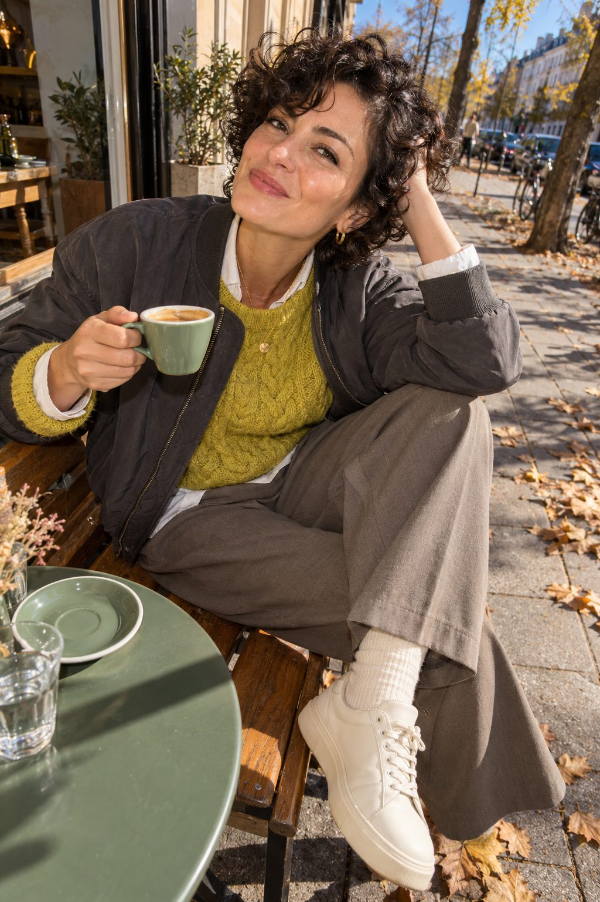
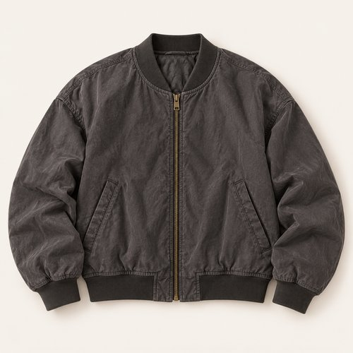
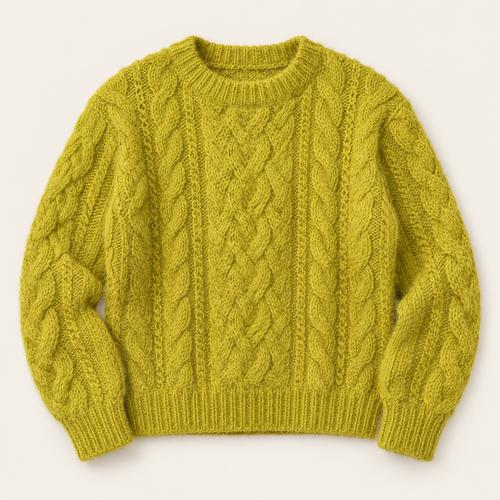
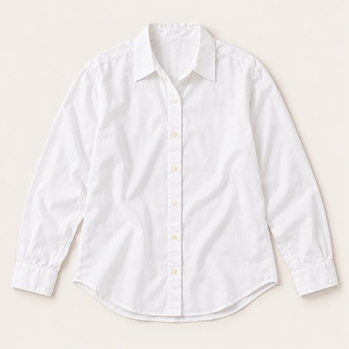
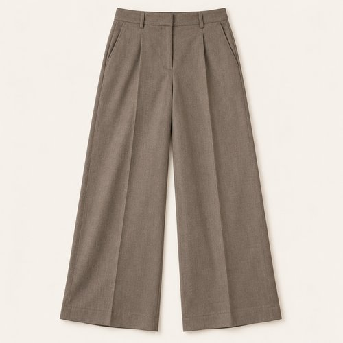
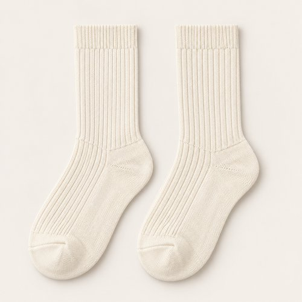
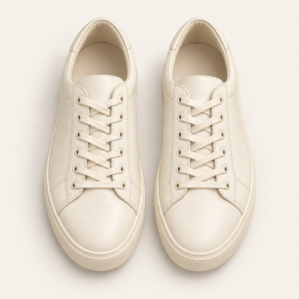
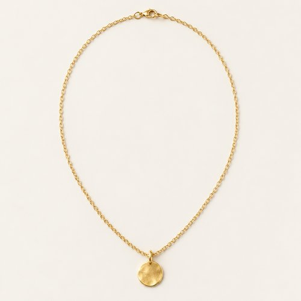
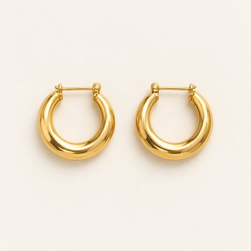

# CAFÉ IN CITRON

| 언어 | 타이틀 |
| --- | --- |
| 한국어 | 카페 인 시트론 |
| English | CAFÉ IN CITRON |
| Deutsch | CAFÉ IN ZITRONGELB |

## 세트 정보

- Sunny / Chilly / Female / 35+ / Day / Street / 06
- 기존 앱 ID: `bd15-06-street-f` - 매핑 시 유지
- 에디토리얼 1장 + 개별 제품 8장
- 기온·체감온도 수치: 확인되지 않음. Chilly는 원본 폴더 기준.
- 앱 매핑: pending. 사용자 요청에 따른 이미지 제작·GitHub 업로드.

## Editorial

기존 `../06-street.jpg`의 앱용 압축 사본. 원본 경로 유지.

## How to wear

### 한국어

차콜 사이로 시트론 한 겹.

차콜 보머 아래 시트론 케이블 니트를 겹치고 화이트 셔츠의 칼라와 커프를 조금 드러내요. 토프 와이드 팬츠와 크림 스니커즈로 부드럽게 이어가고, 작은 골드 톤 주얼리로 마무리해요.

### English

A layer of citron between charcoal and white.

Layer citron cable knit beneath a charcoal bomber, revealing a little white shirt at collar and cuffs. Taupe wide-leg trousers and cream sneakers keep the palette soft; small gold-tone jewellery finishes it.

### Deutsch

Eine Lage Zitrongelb zwischen Anthrazit und Weiß.

Trage zitrongelben Zopfstrick unter einer anthrazitfarbenen Bomberjacke und lasse weißen Hemdkragen und Manschetten hervorschauen. Eine taupefarbene weite Hose, cremefarbene Sneaker und kleine goldfarbene Schmuckstücke runden den Look ab.

## The pieces

| 파일 | 한국어 | English | Deutsch |
| --- | --- | --- | --- |
| [01-outer](products/01-outer.jpg) | 차콜 보머 재킷 | Charcoal Bomber Jacket | Anthrazitfarbene Bomberjacke |
| [02-top](products/02-top.jpg) | 시트론 케이블 니트 | Citron Cable Knit | Zitrongelber Zopfstrickpullover |
| [03-under](products/03-under.jpg) | 화이트 레이어 셔츠 | White Layering Shirt | Weißes Hemd |
| [04-bottom](products/04-bottom.jpg) | 토프 와이드 팬츠 | Taupe Wide-Leg Trousers | Taupefarbene weite Hose |
| [05-socks](products/05-socks.jpg) | 아이보리 리브 삭스 | Ivory Rib Socks | Elfenbeinfarbene Rippensocken |
| [06-shoes](products/06-shoes.jpg) | 크림 로우탑 스니커즈 | Cream Low-Top Sneakers | Cremefarbene Low-Top-Sneaker |
| [07-jewelry](products/07-jewelry.jpg) | 골드 톤 코인 네크리스 | Gold-Tone Coin Necklace | Goldfarbene Münzkette |
| [08-earrings](products/08-earrings.jpg) | 미니 골드 후프 | Mini Gold Hoops | Kleine goldfarbene Creolen |

### 01-outer · Charcoal Bomber Jacket

- KO: 앞을 열어 안쪽 레이어가 보이게 입어요. 소매와 밑단의 볼륨을 자연스럽게 남겨주세요.
- EN: Wear it open to reveal the inner layers, keeping the natural volume of sleeves and hem.
- DE: Trage die Jacke offen, damit die inneren Lagen sichtbar bleiben, und lasse Ärmeln und Saum ihr natürliches Volumen.
- 복원: `visible-item-reconstructed`

### 02-top · Citron Cable Knit

- KO: 아우터 안에서 니트의 표면을 보여줘요. 밑단을 정돈해 와이드 하의의 여유를 살려요.
- EN: Show the knit texture beneath the jacket and keep the hem neat above the wide trousers.
- DE: Zeige die Strickstruktur unter der Jacke und ordne den Saum über der weiten Hose.
- 복원: `partially-visible-reconstructed`

### 03-under · White Layering Shirt

- KO: 니트 아래에 겹쳐 입고 칼라와 커프만 조금 드러내요. 몸판은 겉으로 부풀지 않게 정리해요.
- EN: Layer beneath the knit, showing a little collar and cuff while keeping the body smooth.
- DE: Trage das Hemd unter dem Strick und zeige etwas Kragen und Manschetten, während der Rumpf glatt bleibt.
- 복원: `partially-visible-reconstructed`

### 04-bottom · Taupe Wide-Leg Trousers

- KO: 넉넉한 통을 접거나 조이지 않고 자연스럽게 떨어뜨려요. 상의 밑단을 정돈해 하의의 실루엣을 드러내요.
- EN: Let the generous legs fall naturally and keep the top hem neat so the trouser shape stays visible.
- DE: Lasse die weiten Beine natürlich fallen und ordne das Oberteil, damit die Form der Hose sichtbar bleibt.
- 복원: `partially-visible-reconstructed`

### 05-socks · Ivory Rib Socks

- KO: 팬츠와 신발 사이에 리브 조직을 짧게 드러내요. 발목에 과하게 뭉치지 않게 정리해요.
- EN: Show a short section of ribbing between trousers and shoes without excessive bunching.
- DE: Zeige zwischen Hose und Schuhen etwas Rippstruktur, ohne die Socken stark zu stauchen.
- 복원: `partially-visible-reconstructed`

### 06-shoes · Cream Low-Top Sneakers

- KO: 와이드 하의 아래 앞코와 솔이 드러나게 밑단 길이를 정돈해요.
- EN: Set the trouser length so the toe and sole remain visible beneath the wide leg.
- DE: Wähle die Hosenlänge so, dass Spitze und Sohle unter dem weiten Bein sichtbar bleiben.
- 복원: `partially-visible-reconstructed`

### 07-jewelry · Gold-Tone Coin Necklace

- KO: 니트 위로 작은 펜던트만 드러내요. 가는 체인으로 목선의 레이어를 가볍게 이어줘요.
- EN: Let the small pendant sit over the knit, keeping the neckline light with a fine chain.
- DE: Lasse den kleinen Anhänger über dem Strick liegen und halte den Ausschnitt mit einer feinen Kette leicht.
- 복원: `partially-visible-reconstructed`

### 08-earrings · Mini Gold Hoops

- KO: 작은 후프로 얼굴 가까이에 은은한 포인트를 더해요. 목걸이와 비슷한 금속 톤으로 정리해요.
- EN: Add a subtle accent near the face with small earrings, keeping the metal tone coordinated.
- DE: Setze mit kleinen Ohrringen einen dezenten Akzent am Gesicht und stimme den Metallton ab.
- 복원: `partially-visible-reconstructed`

## 제작·검수·인수인계

- AI 스타일링 콘셉트 제품 컷. 실제 판매 상품이나 브랜드를 나타내지 않음.
- 뒷면·허리·이너 몸판·가방 뒷면·신발 반대쪽·주얼리 잠금 구조는 추정 복원.
- 소재 명칭은 외관의 묘사이며 실제 소재 혼용률·금속 성분·기능·가격은 확인되지 않음.
- 제품별 한 파일. 신발·양말·귀걸이 한 쌍은 한 아이템.
- 에디토리얼 1024×1536 JPG ≤300KB. 제품별 500×500 JPG ≤50KB.
- 식음료·식기·종이 쇼핑백·열쇠는 장면 소품으로 제외.
- 앱 카피에는 날씨 수치를 넣지 않고 메타데이터와 분리.
- 기존 룩 ID와 기존 에디토리얼 경로를 보존하며 새 제품 파일을 연결할 것.
- 현재 업로드만 수행. 앱 매핑은 pending.
