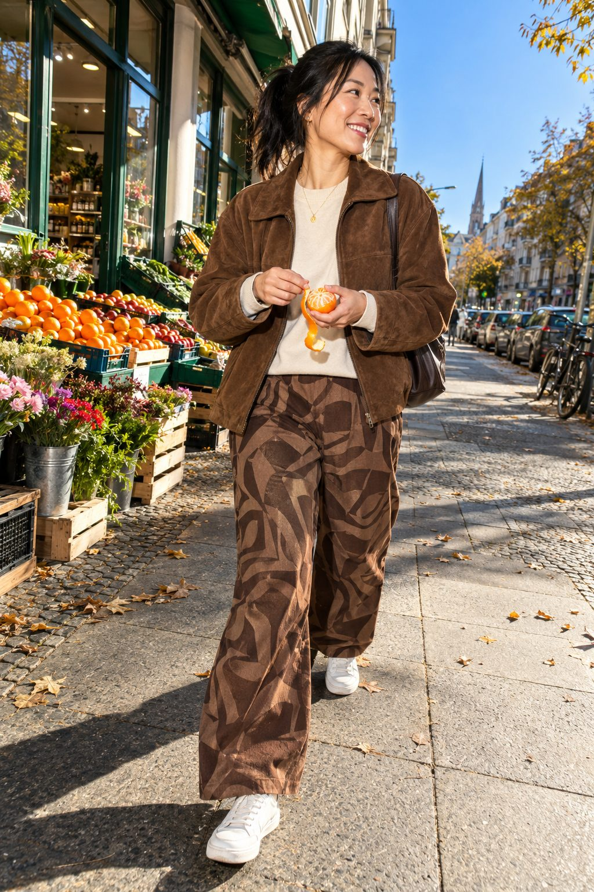
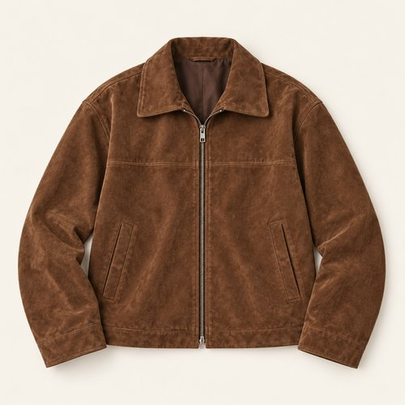
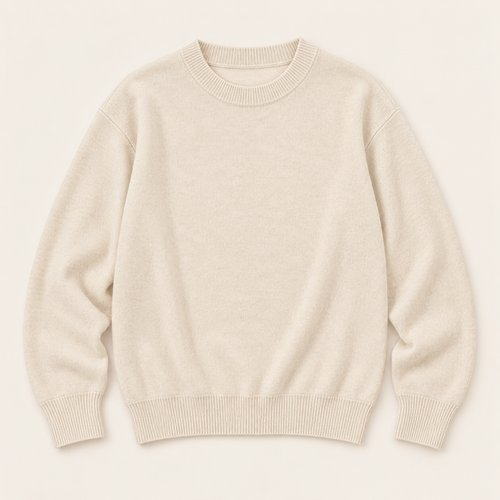
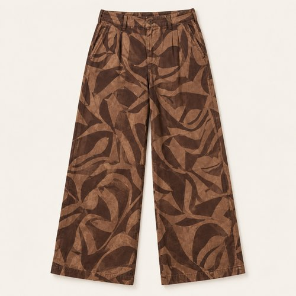
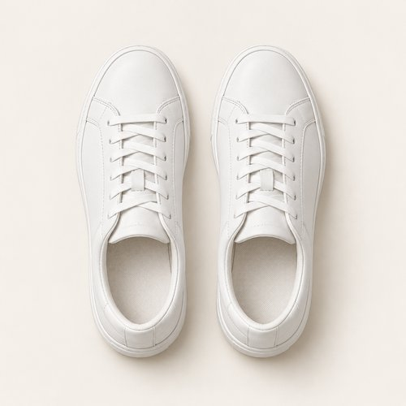
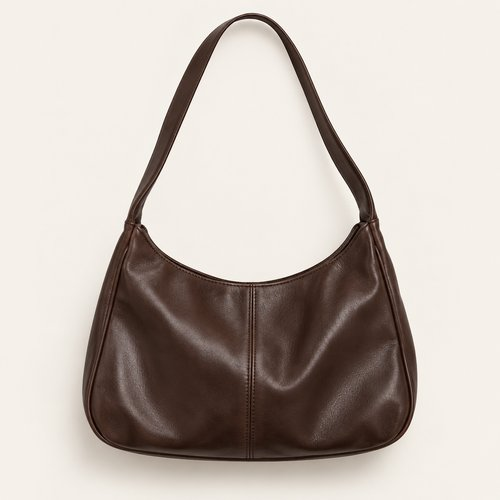
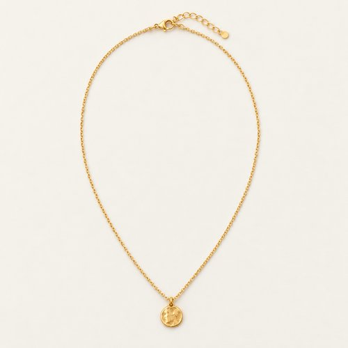
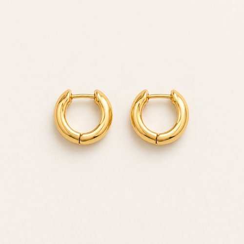

# BROWN, WITH A PATTERN

| 언어 | 타이틀 |
| --- | --- |
| 한국어 | 브라운 위드 어 패턴 |
| English | BROWN, WITH A PATTERN |
| Deutsch | BRAUN MIT MUSTER |

## 세트 정보

- Sunny / Chilly / Female / 35+ / Day / Street / 07
- 기존 앱 ID: `bd15-07-street-f` - 매핑 시 유지
- 에디토리얼 1장 + 개별 제품 7장
- 기온·체감온도 수치: 확인되지 않음. Chilly는 원본 폴더 기준.
- 앱 매핑: pending. 사용자 요청에 따른 이미지 제작·GitHub 업로드.

## Editorial

기존 `../07-street.jpg`의 앱용 압축 사본. 원본 경로 유지.

## How to wear

### 한국어

브라운의 농도는 다르게, 패턴은 크게.

스웨이드의 매트한 표면과 그래픽 팬츠의 큰 패턴을 한 색 계열로 묶어요. 크림 니트를 사이에 두고 화이트 스니커즈로 발끝을 밝히면, 브라운 숄더백까지 자연스럽게 이어져요.

### English

Different shades of brown. One bold pattern.

Bring matte suede and a large trouser pattern together through shades of brown. A cream knit and white sneakers lighten the composition, while a chocolate shoulder bag keeps it connected.

### Deutsch

Verschiedene Brauntöne. Ein großes Muster.

Verbinde matte Wildlederoptik und ein großes Hosenmuster durch verschiedene Brauntöne. Cremefarbener Strick und weiße Sneaker hellen den Look auf; eine schokoladenbraune Schultertasche führt die Palette fort.

## The pieces

| 파일 | 한국어 | English | Deutsch |
| --- | --- | --- | --- |
| [01-outer](products/01-outer.jpg) | 브라운 스웨이드 재킷 | Brown Suede Jacket | Braune Wildlederjacke |
| [02-top](products/02-top.jpg) | 크림 크루넥 니트 | Cream Crew-Neck Knit | Cremefarbener Rundhalspullover |
| [03-bottom](products/03-bottom.jpg) | 브라운 그래픽 와이드 팬츠 | Brown Graphic Wide-Leg Trousers | Braune weite Hose mit Grafikmuster |
| [04-shoes](products/04-shoes.jpg) | 화이트 코트 스니커즈 | White Court Sneakers | Weiße Court-Sneaker |
| [05-bag](products/05-bag.jpg) | 초콜릿 숄더백 | Chocolate Shoulder Bag | Schokoladenbraune Schultertasche |
| [06-jewelry](products/06-jewelry.jpg) | 골드 톤 펜던트 네크리스 | Gold-Tone Pendant Necklace | Goldfarbene Halskette mit Anhänger |
| [07-earrings](products/07-earrings.jpg) | 미니 골드 이어링 | Mini Gold Earrings | Kleine goldfarbene Ohrringe |

### 01-outer · Brown Suede Jacket

- KO: 앞을 열어 안쪽 레이어가 보이게 입어요. 소매와 밑단의 볼륨을 자연스럽게 남겨주세요.
- EN: Wear it open to reveal the inner layers, keeping the natural volume of sleeves and hem.
- DE: Trage die Jacke offen, damit die inneren Lagen sichtbar bleiben, und lasse Ärmeln und Saum ihr natürliches Volumen.
- 복원: `visible-item-reconstructed`

### 02-top · Cream Crew-Neck Knit

- KO: 아우터 안에서 니트의 표면을 보여줘요. 밑단을 정돈해 와이드 하의의 여유를 살려요.
- EN: Show the knit texture beneath the jacket and keep the hem neat above the wide trousers.
- DE: Zeige die Strickstruktur unter der Jacke und ordne den Saum über der weiten Hose.
- 복원: `partially-visible-reconstructed`

### 03-bottom · Brown Graphic Wide-Leg Trousers

- KO: 큰 그래픽 패턴을 브라운 재킷과 같은 계열로 연결해요. 크림 니트는 단색으로 두어 패턴이 잘 보이게 해요.
- EN: Link the large graphic pattern to the brown jacket and keep the cream knit plain so the print stands out.
- DE: Verbinde das große Grafikmuster mit der braunen Jacke und halte den cremefarbenen Pullover schlicht, damit das Muster wirkt.
- 복원: `partially-visible-reconstructed`

### 04-shoes · White Court Sneakers

- KO: 와이드 하의 아래 앞코와 솔이 드러나게 밑단 길이를 정돈해요.
- EN: Set the trouser length so the toe and sole remain visible beneath the wide leg.
- DE: Wähle die Hosenlänge so, dass Spitze und Sohle unter dem weiten Bein sichtbar bleiben.
- 복원: `partially-visible-reconstructed`

### 05-bag · Chocolate Shoulder Bag

- KO: 몸 가까이 걸쳐 실루엣을 간결하게 정리해요. 스트랩은 겉옷 위에서 자연스럽게 이어줘요.
- EN: Carry close to the body for a clean silhouette, letting the strap sit naturally over the outer layer.
- DE: Trage die Tasche nah am Körper und lasse den Riemen natürlich über der äußeren Lage liegen.
- 복원: `partially-visible-reconstructed`

### 06-jewelry · Gold-Tone Pendant Necklace

- KO: 니트 위로 작은 펜던트만 드러내요. 가는 체인으로 목선의 레이어를 가볍게 이어줘요.
- EN: Let the small pendant sit over the knit, keeping the neckline light with a fine chain.
- DE: Lasse den kleinen Anhänger über dem Strick liegen und halte den Ausschnitt mit einer feinen Kette leicht.
- 복원: `partially-visible-reconstructed`

### 07-earrings · Mini Gold Earrings

- KO: 작은 후프로 얼굴 가까이에 은은한 포인트를 더해요. 목걸이와 비슷한 금속 톤으로 정리해요.
- EN: Add a subtle accent near the face with small earrings, keeping the metal tone coordinated.
- DE: Setze mit kleinen Ohrringen einen dezenten Akzent am Gesicht und stimme den Metallton ab.
- 복원: `partially-visible-reconstructed`

## 제작·검수·인수인계

- AI 스타일링 콘셉트 제품 컷. 실제 판매 상품이나 브랜드를 나타내지 않음.
- 뒷면·허리·이너 몸판·가방 뒷면·신발 반대쪽·주얼리 잠금 구조는 추정 복원.
- 소재 명칭은 외관의 묘사이며 실제 소재 혼용률·금속 성분·기능·가격은 확인되지 않음.
- 제품별 한 파일. 신발·양말·귀걸이 한 쌍은 한 아이템.
- 에디토리얼 1024×1536 JPG ≤300KB. 제품별 500×500 JPG ≤50KB.
- 식음료·식기·종이 쇼핑백·열쇠는 장면 소품으로 제외.
- 앱 카피에는 날씨 수치를 넣지 않고 메타데이터와 분리.
- 기존 룩 ID와 기존 에디토리얼 경로를 보존하며 새 제품 파일을 연결할 것.
- 현재 업로드만 수행. 앱 매핑은 pending.
- 양말은 명확히 보이지 않아 별도 생성하지 않음.
