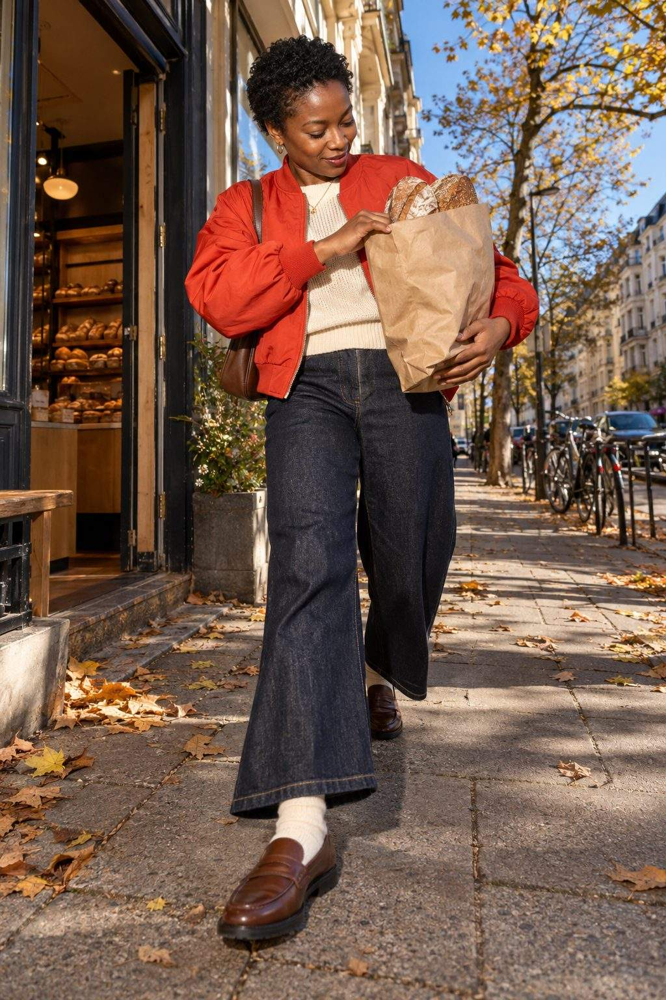
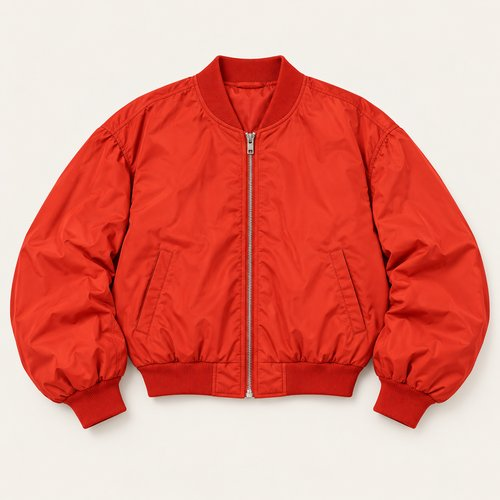
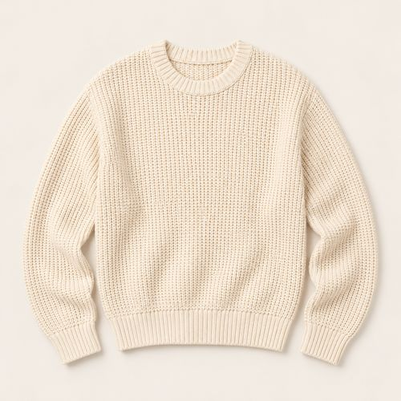
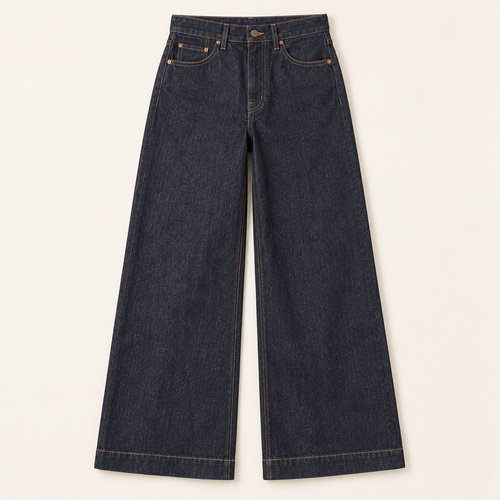
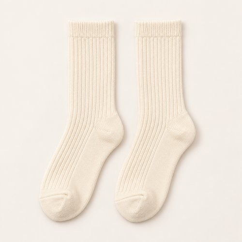
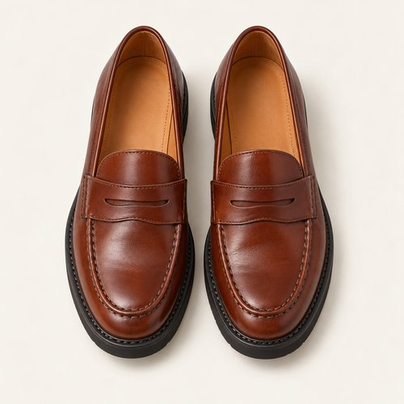
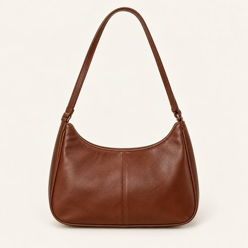
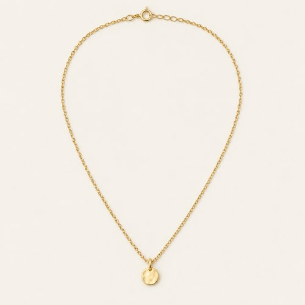
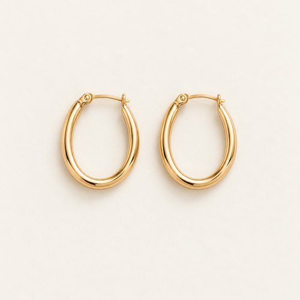

# RED ON THE BLOCK

| 언어 | 타이틀 |
| --- | --- |
| 한국어 | 레드 온 더 블록 |
| English | RED ON THE BLOCK |
| Deutsch | ROT IM VIERTEL |

## 세트 정보

- Sunny / Chilly / Female / 35+ / Day / Street / 08
- 기존 앱 ID: `bd15-08-street-f` - 매핑 시 유지
- 에디토리얼 1장 + 개별 제품 8장
- 기온·체감온도 수치: 확인되지 않음. Chilly는 원본 폴더 기준.
- 앱 매핑: pending. 사용자 요청에 따른 이미지 제작·GitHub 업로드.

## Editorial

기존 `../08-street.jpg`의 앱용 압축 사본. 원본 경로 유지.

## How to wear

### 한국어

레드 보머, 인디고 데님, 브라운 로퍼.

레드 보머의 둥근 볼륨을 와이드 인디고 데님으로 받쳐요. 크림 니트와 리브 삭스를 연결하고, 브라운 페니 로퍼와 숄더백으로 선명한 상의 색을 정리해요.

### English

Red bomber. Indigo denim. Brown loafers.

Balance a rounded red bomber with wide indigo denim. Link cream knit to ribbed socks, then ground the vivid jacket with brown penny loafers and a shoulder bag.

### Deutsch

Rote Bomberjacke. Indigojeans. Braune Loafer.

Gleiche die runde Form der roten Bomberjacke mit weiten Indigojeans aus. Verbinde cremefarbenen Strick mit Rippensocken und erde die kräftige Jacke durch braune Pennyloafer und eine Schultertasche.

## The pieces

| 파일 | 한국어 | English | Deutsch |
| --- | --- | --- | --- |
| [01-outer](products/01-outer.jpg) | 레드 볼륨 보머 | Red Volume Bomber | Rote voluminöse Bomberjacke |
| [02-top](products/02-top.jpg) | 크림 텍스처 니트 | Cream Textured Knit | Cremefarbener Strukturpullover |
| [03-bottom](products/03-bottom.jpg) | 인디고 와이드 데님 | Indigo Wide-Leg Denim | Indigoblaue weite Jeans |
| [04-socks](products/04-socks.jpg) | 크림 리브 삭스 | Cream Rib Socks | Cremefarbene Rippensocken |
| [05-shoes](products/05-shoes.jpg) | 브라운 페니 로퍼 | Brown Penny Loafers | Braune Pennyloafer |
| [06-bag](products/06-bag.jpg) | 체스트넛 숄더백 | Chestnut Shoulder Bag | Kastanienbraune Schultertasche |
| [07-jewelry](products/07-jewelry.jpg) | 골드 톤 미니 펜던트 | Gold-Tone Mini Pendant | Goldfarbener kleiner Anhänger |
| [08-earrings](products/08-earrings.jpg) | 골드 톤 슬림 후프 | Gold-Tone Slim Hoops | Schmale goldfarbene Creolen |

### 01-outer · Red Volume Bomber

- KO: 앞을 열어 안쪽 레이어가 보이게 입어요. 소매와 밑단의 볼륨을 자연스럽게 남겨주세요.
- EN: Wear it open to reveal the inner layers, keeping the natural volume of sleeves and hem.
- DE: Trage die Jacke offen, damit die inneren Lagen sichtbar bleiben, und lasse Ärmeln und Saum ihr natürliches Volumen.
- 복원: `visible-item-reconstructed`

### 02-top · Cream Textured Knit

- KO: 아우터 안에서 니트의 표면을 보여줘요. 밑단을 정돈해 와이드 하의의 여유를 살려요.
- EN: Show the knit texture beneath the jacket and keep the hem neat above the wide trousers.
- DE: Zeige die Strickstruktur unter der Jacke und ordne den Saum über der weiten Hose.
- 복원: `partially-visible-reconstructed`

### 03-bottom · Indigo Wide-Leg Denim

- KO: 넉넉한 통을 접거나 조이지 않고 자연스럽게 떨어뜨려요. 상의 밑단을 정돈해 하의의 실루엣을 드러내요.
- EN: Let the generous legs fall naturally and keep the top hem neat so the trouser shape stays visible.
- DE: Lasse die weiten Beine natürlich fallen und ordne das Oberteil, damit die Form der Hose sichtbar bleibt.
- 복원: `partially-visible-reconstructed`

### 04-socks · Cream Rib Socks

- KO: 팬츠와 신발 사이에 리브 조직을 짧게 드러내요. 발목에 과하게 뭉치지 않게 정리해요.
- EN: Show a short section of ribbing between trousers and shoes without excessive bunching.
- DE: Zeige zwischen Hose und Schuhen etwas Rippstruktur, ohne die Socken stark zu stauchen.
- 복원: `partially-visible-reconstructed`

### 05-shoes · Brown Penny Loafers

- KO: 브라운 페니 로퍼 위에 크림 삭스를 드러내요. 짙은 데님의 넓은 밑단과 클래식한 앞코를 함께 보여줘요.
- EN: Show cream socks above brown penny loafers and let the broad denim hem frame the classic toe.
- DE: Zeige cremefarbene Socken über den braunen Pennyloafern und lasse den weiten Jeanssaum die klassische Spitze einrahmen.
- 복원: `partially-visible-reconstructed`

### 06-bag · Chestnut Shoulder Bag

- KO: 몸 가까이 걸쳐 실루엣을 간결하게 정리해요. 스트랩은 겉옷 위에서 자연스럽게 이어줘요.
- EN: Carry close to the body for a clean silhouette, letting the strap sit naturally over the outer layer.
- DE: Trage die Tasche nah am Körper und lasse den Riemen natürlich über der äußeren Lage liegen.
- 복원: `partially-visible-reconstructed`

### 07-jewelry · Gold-Tone Mini Pendant

- KO: 니트 위로 작은 펜던트만 드러내요. 가는 체인으로 목선의 레이어를 가볍게 이어줘요.
- EN: Let the small pendant sit over the knit, keeping the neckline light with a fine chain.
- DE: Lasse den kleinen Anhänger über dem Strick liegen und halte den Ausschnitt mit einer feinen Kette leicht.
- 복원: `partially-visible-reconstructed`

### 08-earrings · Gold-Tone Slim Hoops

- KO: 작은 후프로 얼굴 가까이에 은은한 포인트를 더해요. 목걸이와 비슷한 금속 톤으로 정리해요.
- EN: Add a subtle accent near the face with small earrings, keeping the metal tone coordinated.
- DE: Setze mit kleinen Ohrringen einen dezenten Akzent am Gesicht und stimme den Metallton ab.
- 복원: `partially-visible-reconstructed`

## 제작·검수·인수인계

- AI 스타일링 콘셉트 제품 컷. 실제 판매 상품이나 브랜드를 나타내지 않음.
- 뒷면·허리·이너 몸판·가방 뒷면·신발 반대쪽·주얼리 잠금 구조는 추정 복원.
- 소재 명칭은 외관의 묘사이며 실제 소재 혼용률·금속 성분·기능·가격은 확인되지 않음.
- 제품별 한 파일. 신발·양말·귀걸이 한 쌍은 한 아이템.
- 에디토리얼 1024×1536 JPG ≤300KB. 제품별 500×500 JPG ≤50KB.
- 식음료·식기·종이 쇼핑백·열쇠는 장면 소품으로 제외.
- 앱 카피에는 날씨 수치를 넣지 않고 메타데이터와 분리.
- 기존 룩 ID와 기존 에디토리얼 경로를 보존하며 새 제품 파일을 연결할 것.
- 현재 업로드만 수행. 앱 매핑은 pending.
