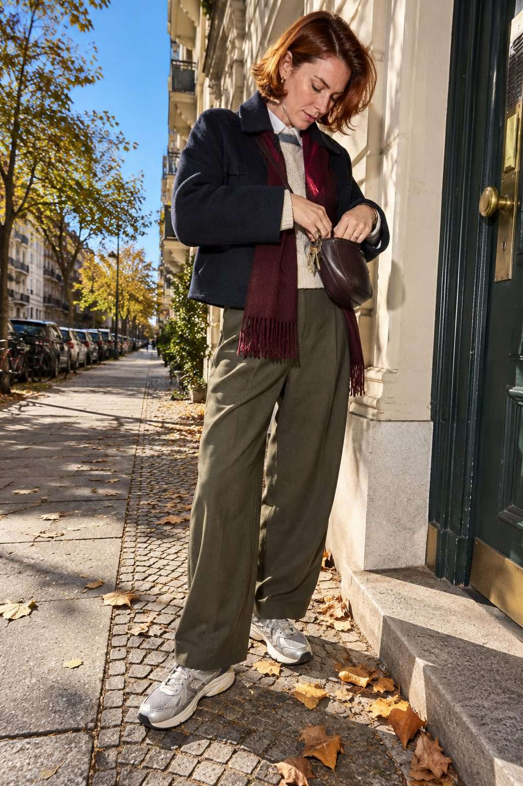
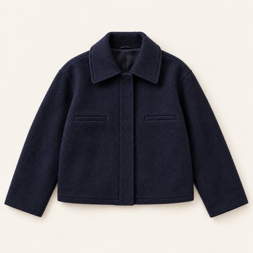
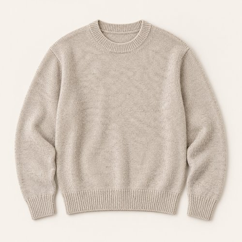
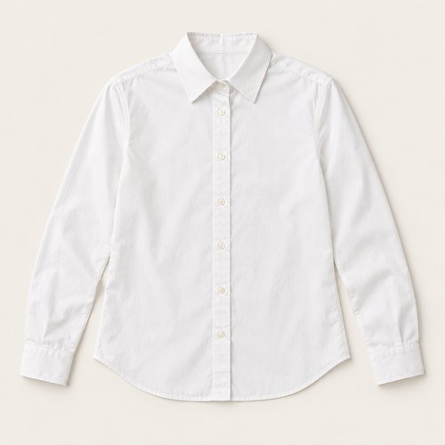
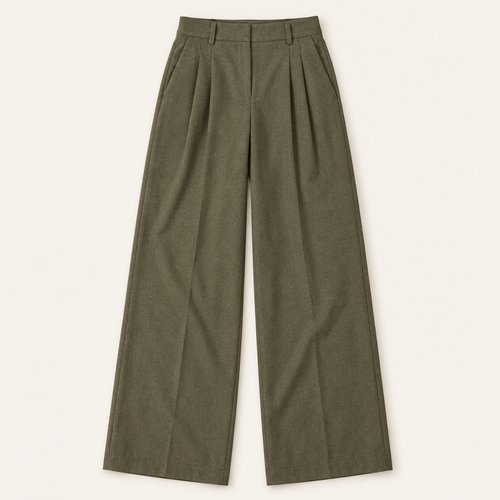
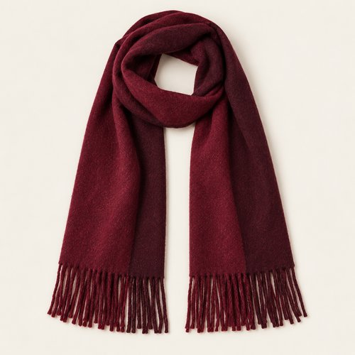
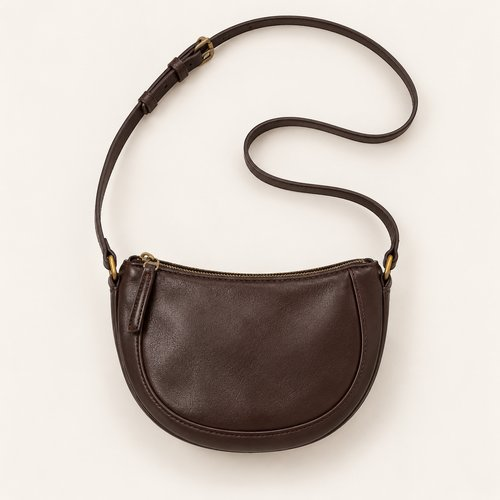
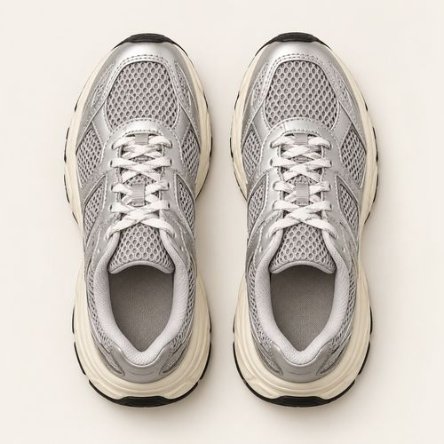
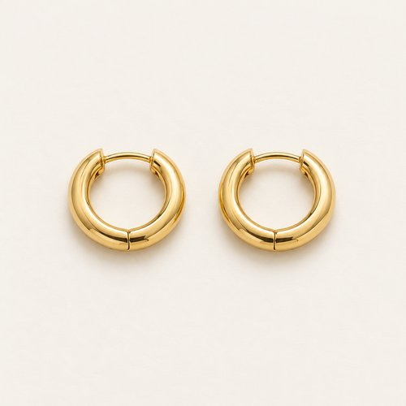
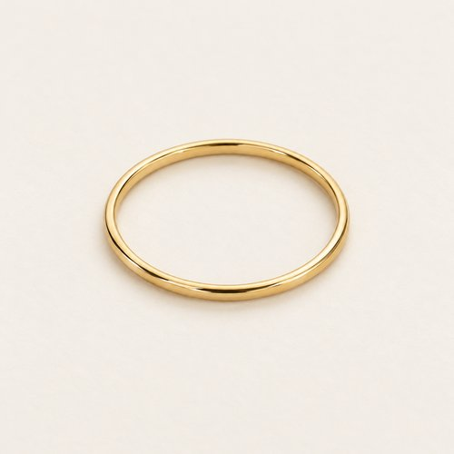

# BURGUNDY AT THE DOOR

| 언어 | 타이틀 |
| --- | --- |
| 한국어 | 버건디 앳 더 도어 |
| English | BURGUNDY AT THE DOOR |
| Deutsch | BURGUNDER AN DER TÜR |

## 세트 정보

- Sunny / Chilly / Female / 35+ / Day / Street / 09
- 기존 앱 ID: `bd15-09-street-f` - 매핑 시 유지
- 에디토리얼 1장 + 개별 제품 9장
- 기온·체감온도 수치: 확인되지 않음. Chilly는 원본 폴더 기준.
- 앱 매핑: pending. 사용자 요청에 따른 이미지 제작·GitHub 업로드.

## Editorial

기존 `../09-street.jpg`의 앱용 압축 사본. 원본 경로 유지.

## How to wear

### 한국어

네이비와 올리브 사이, 길게 떨어지는 버건디.

짧은 네이비 재킷 안에 화이트 셔츠와 오트밀 니트를 겹쳐요. 버건디 머플러를 길게 늘어뜨려 올리브 팬츠의 넉넉한 실루엣과 연결하고, 실버 러너와 작은 크로스바디로 가볍게 마무리해요.

### English

A long burgundy line between navy and olive.

Layer a white shirt and oatmeal knit inside a short navy jacket. Let a burgundy scarf fall long against generous olive trousers, finishing with silver runners and a small crossbody bag.

### Deutsch

Eine lange burgunderfarbene Linie zwischen Marineblau und Oliv.

Schichte ein weißes Hemd und einen haferfarbenen Pullover unter eine kurze marineblaue Jacke. Lasse den burgunderfarbenen Schal lang über die weite olivgrüne Hose fallen und ergänze silberne Sneaker sowie eine kleine Umhängetasche.

## The pieces

| 파일 | 한국어 | English | Deutsch |
| --- | --- | --- | --- |
| [01-outer](products/01-outer.jpg) | 네이비 크롭 재킷 | Navy Cropped Jacket | Kurze marineblaue Jacke |
| [02-top](products/02-top.jpg) | 오트밀 크루넥 니트 | Oatmeal Crew-Neck Knit | Haferfarbener Rundhalspullover |
| [03-under](products/03-under.jpg) | 화이트 포인트 칼라 셔츠 | White Point-Collar Shirt | Weißes Hemd mit spitzem Kragen |
| [04-bottom](products/04-bottom.jpg) | 올리브 플리츠 팬츠 | Olive Pleated Trousers | Olivgrüne Bundfaltenhose |
| [05-scarf](products/05-scarf.jpg) | 버건디 프린지 머플러 | Burgundy Fringed Scarf | Burgunderfarbener Fransenschal |
| [06-bag](products/06-bag.jpg) | 에스프레소 크로스바디 | Espresso Crossbody Bag | Espressobraune Umhängetasche |
| [07-shoes](products/07-shoes.jpg) | 실버 그레이 러너 | Silver-Grey Runners | Silbergraue Sneaker |
| [08-earrings](products/08-earrings.jpg) | 미니 골드 후프 | Mini Gold Hoops | Kleine goldfarbene Creolen |
| [09-ring](products/09-ring.jpg) | 골드 톤 슬림 링 | Gold-Tone Slim Ring | Schmaler goldfarbener Ring |

### 01-outer · Navy Cropped Jacket

- KO: 앞을 열어 안쪽 레이어가 보이게 입어요. 소매와 밑단의 볼륨을 자연스럽게 남겨주세요.
- EN: Wear it open to reveal the inner layers, keeping the natural volume of sleeves and hem.
- DE: Trage die Jacke offen, damit die inneren Lagen sichtbar bleiben, und lasse Ärmeln und Saum ihr natürliches Volumen.
- 복원: `visible-item-reconstructed`

### 02-top · Oatmeal Crew-Neck Knit

- KO: 아우터 안에서 니트의 표면을 보여줘요. 밑단을 정돈해 와이드 하의의 여유를 살려요.
- EN: Show the knit texture beneath the jacket and keep the hem neat above the wide trousers.
- DE: Zeige die Strickstruktur unter der Jacke und ordne den Saum über der weiten Hose.
- 복원: `partially-visible-reconstructed`

### 03-under · White Point-Collar Shirt

- KO: 니트 아래에 겹쳐 입고 칼라와 커프만 조금 드러내요. 몸판은 겉으로 부풀지 않게 정리해요.
- EN: Layer beneath the knit, showing a little collar and cuff while keeping the body smooth.
- DE: Trage das Hemd unter dem Strick und zeige etwas Kragen und Manschetten, während der Rumpf glatt bleibt.
- 복원: `partially-visible-reconstructed`

### 04-bottom · Olive Pleated Trousers

- KO: 넉넉한 통을 접거나 조이지 않고 자연스럽게 떨어뜨려요. 상의 밑단을 정돈해 하의의 실루엣을 드러내요.
- EN: Let the generous legs fall naturally and keep the top hem neat so the trouser shape stays visible.
- DE: Lasse die weiten Beine natürlich fallen und ordne das Oberteil, damit die Form der Hose sichtbar bleibt.
- 복원: `partially-visible-reconstructed`

### 05-scarf · Burgundy Fringed Scarf

- KO: 목에 한 번 두르고 양 끝을 길게 늘어뜨려요. 프린지가 하의 위로 자연스럽게 이어지게 해요.
- EN: Wrap once around the neck and let the ends fall long, with the fringe resting over the trousers.
- DE: Lege den Schal einmal um den Hals und lasse die Enden lang über die Hose fallen.
- 복원: `partially-visible-reconstructed`

### 06-bag · Espresso Crossbody Bag

- KO: 몸 가까이 걸쳐 실루엣을 간결하게 정리해요. 스트랩은 겉옷 위에서 자연스럽게 이어줘요.
- EN: Carry close to the body for a clean silhouette, letting the strap sit naturally over the outer layer.
- DE: Trage die Tasche nah am Körper und lasse den Riemen natürlich über der äußeren Lage liegen.
- 복원: `partially-visible-reconstructed`

### 07-shoes · Silver-Grey Runners

- KO: 와이드 하의 아래 앞코와 솔이 드러나게 밑단 길이를 정돈해요.
- EN: Set the trouser length so the toe and sole remain visible beneath the wide leg.
- DE: Wähle die Hosenlänge so, dass Spitze und Sohle unter dem weiten Bein sichtbar bleiben.
- 복원: `partially-visible-reconstructed`

### 08-earrings · Mini Gold Hoops

- KO: 작은 후프로 얼굴 가까이에 은은한 포인트를 더해요. 목걸이와 비슷한 금속 톤으로 정리해요.
- EN: Add a subtle accent near the face with small earrings, keeping the metal tone coordinated.
- DE: Setze mit kleinen Ohrringen einen dezenten Akzent am Gesicht und stimme den Metallton ab.
- 복원: `partially-visible-reconstructed`

### 09-ring · Gold-Tone Slim Ring

- KO: 얇은 링 하나로 손의 디테일을 더해요. 다른 액세서리와 골드 톤을 맞춰요.
- EN: Add a single slim ring and coordinate its gold tone with the other accessories.
- DE: Ergänze einen einzelnen schmalen Ring und stimme seinen Goldton auf die übrigen Accessoires ab.
- 복원: `partially-visible-reconstructed`

## 제작·검수·인수인계

- AI 스타일링 콘셉트 제품 컷. 실제 판매 상품이나 브랜드를 나타내지 않음.
- 뒷면·허리·이너 몸판·가방 뒷면·신발 반대쪽·주얼리 잠금 구조는 추정 복원.
- 소재 명칭은 외관의 묘사이며 실제 소재 혼용률·금속 성분·기능·가격은 확인되지 않음.
- 제품별 한 파일. 신발·양말·귀걸이 한 쌍은 한 아이템.
- 에디토리얼 1024×1536 JPG ≤300KB. 제품별 500×500 JPG ≤50KB.
- 식음료·식기·종이 쇼핑백·열쇠는 장면 소품으로 제외.
- 앱 카피에는 날씨 수치를 넣지 않고 메타데이터와 분리.
- 기존 룩 ID와 기존 에디토리얼 경로를 보존하며 새 제품 파일을 연결할 것.
- 현재 업로드만 수행. 앱 매핑은 pending.
- 양말은 명확히 보이지 않아 별도 생성하지 않음.
- 손목의 작은 디테일은 시계인지 확인되지 않아 제품으로 확정하지 않음.
