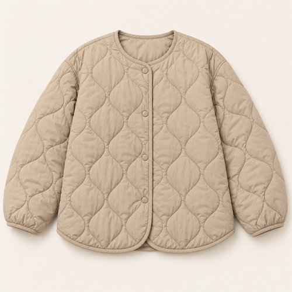
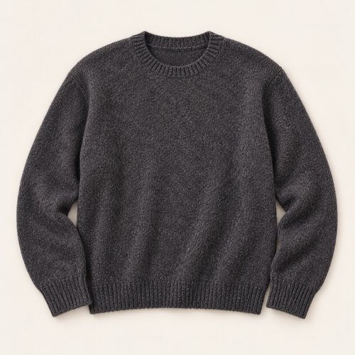
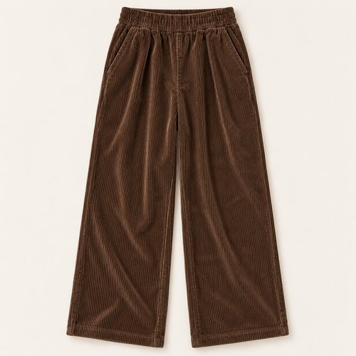
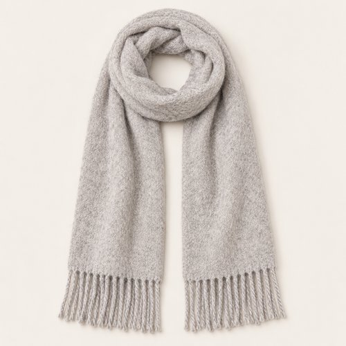
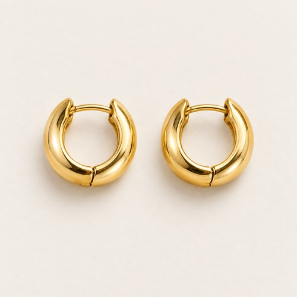
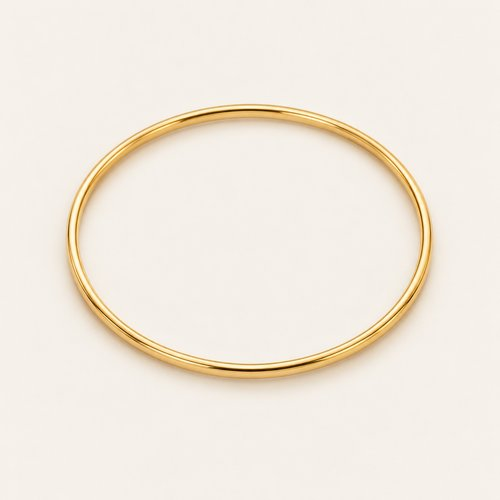
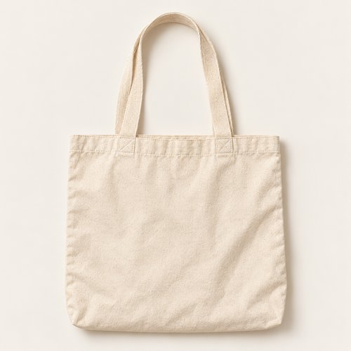

# SOFT TEXTURE, CITY BREAK

| 언어 | 타이틀 |
| --- | --- |
| 한국어 | 소프트 텍스처 시티 브레이크 |
| English | SOFT TEXTURE, CITY BREAK |
| Deutsch | WEICHE TEXTUREN, KURZE PAUSE |

## 세트 정보

- Sunny / Chilly / Female / 35+ / Day / Street / 10
- 기존 앱 ID: `bd15-10-street-f` - 매핑 시 유지
- 에디토리얼 1장 + 개별 제품 7장
- 기온·체감온도 수치: 확인되지 않음. Chilly는 원본 폴더 기준.
- 앱 매핑: pending. 사용자 요청에 따른 이미지 제작·GitHub 업로드.

## Editorial

기존 `../10-street.jpg`의 앱용 압축 사본. 원본 경로 유지.

## How to wear

### 한국어

퀼팅, 니트, 코듀로이. 부드러운 표면을 겹쳐요.

샌드 퀼팅 재킷 안에 차콜 니트를 넣고, 밝은 그레이 머플러를 목에서 길게 이어줘요. 브라운 코듀로이의 굵은 골과 내추럴 캔버스 백으로 소재의 차이를 살리고, 작은 골드 톤 액세서리로 정리해요.

### English

Quilting, knit and corduroy. Softness in layers.

Wear charcoal knit beneath a sand quilted jacket and let a light grey scarf fall long from the neck. Wide-wale brown corduroy and a natural canvas bag add texture, with small gold-tone accessories to finish.

### Deutsch

Steppung, Strick und Cord. Weiche Texturen in Schichten.

Trage anthrazitfarbenen Strick unter einer sandfarbenen Steppjacke und lasse einen hellgrauen Schal lang fallen. Grober brauner Cord und eine naturfarbene Canvas-Tasche ergänzen Textur; kleine goldfarbene Accessoires runden den Look ab.

## The pieces

| 파일 | 한국어 | English | Deutsch |
| --- | --- | --- | --- |
| [01-outer](products/01-outer.jpg) | 샌드 퀼팅 재킷 | Sand Quilted Jacket | Sandfarbene Steppjacke |
| [02-top](products/02-top.jpg) | 차콜 헤더 니트 | Charcoal Heather Knit | Anthrazitfarbener melierter Pullover |
| [03-bottom](products/03-bottom.jpg) | 브라운 코듀로이 팬츠 | Brown Corduroy Trousers | Braune Cordhose |
| [04-scarf](products/04-scarf.jpg) | 라이트 그레이 프린지 머플러 | Light Grey Fringed Scarf | Hellgrauer Fransenschal |
| [05-earrings](products/05-earrings.jpg) | 골드 톤 허기 후프 | Gold-Tone Huggie Hoops | Goldfarbene Huggie-Creolen |
| [06-bracelet](products/06-bracelet.jpg) | 골드 톤 슬림 뱅글 | Gold-Tone Slim Bangle | Schmaler goldfarbener Armreif |
| [07-bag](products/07-bag.jpg) | 내추럴 캔버스 토트 | Natural Canvas Tote | Naturfarbene Canvas-Tasche |

### 01-outer · Sand Quilted Jacket

- KO: 앞을 열어 안쪽 레이어가 보이게 입어요. 소매와 밑단의 볼륨을 자연스럽게 남겨주세요.
- EN: Wear it open to reveal the inner layers, keeping the natural volume of sleeves and hem.
- DE: Trage die Jacke offen, damit die inneren Lagen sichtbar bleiben, und lasse Ärmeln und Saum ihr natürliches Volumen.
- 복원: `visible-item-reconstructed`

### 02-top · Charcoal Heather Knit

- KO: 아우터 안에서 니트의 표면을 보여줘요. 밑단을 정돈해 와이드 하의의 여유를 살려요.
- EN: Show the knit texture beneath the jacket and keep the hem neat above the wide trousers.
- DE: Zeige die Strickstruktur unter der Jacke und ordne den Saum über der weiten Hose.
- 복원: `partially-visible-reconstructed`

### 03-bottom · Brown Corduroy Trousers

- KO: 굵은 코듀로이 골을 눌러 펴지 않고 자연스러운 주름으로 남겨요. 퀼팅과 니트의 다른 표면을 함께 살려요.
- EN: Leave the wide cord ribs and soft folds natural, contrasting them with quilting and knit.
- DE: Lasse die breiten Cordrippen und weichen Falten natürlich und kontrastiere sie mit Steppung und Strick.
- 복원: `partially-visible-reconstructed`

### 04-scarf · Light Grey Fringed Scarf

- KO: 목에 한 번 두르고 양 끝을 길게 늘어뜨려요. 프린지가 하의 위로 자연스럽게 이어지게 해요.
- EN: Wrap once around the neck and let the ends fall long, with the fringe resting over the trousers.
- DE: Lege den Schal einmal um den Hals und lasse die Enden lang über die Hose fallen.
- 복원: `partially-visible-reconstructed`

### 05-earrings · Gold-Tone Huggie Hoops

- KO: 작은 후프로 얼굴 가까이에 은은한 포인트를 더해요. 목걸이와 비슷한 금속 톤으로 정리해요.
- EN: Add a subtle accent near the face with small earrings, keeping the metal tone coordinated.
- DE: Setze mit kleinen Ohrringen einen dezenten Akzent am Gesicht und stimme den Metallton ab.
- 복원: `partially-visible-reconstructed`

### 06-bracelet · Gold-Tone Slim Bangle

- KO: 소매 끝에서 가는 뱅글이 조금 보이게 해요. 과한 장식 없이 손목에 작은 포인트를 남겨요.
- EN: Reveal a little of the slim bangle at the cuff for a small wrist accent.
- DE: Lasse am Ärmel etwas vom schmalen Armreif sichtbar, als kleinen Akzent am Handgelenk.
- 복원: `partially-visible-reconstructed`

### 07-bag · Natural Canvas Tote

- KO: 내추럴 캔버스의 부드러운 형태를 그대로 살려요. 브라운 팬츠 옆에 밝은 면을 더하는 소품이에요.
- EN: Keep the natural canvas soft, adding a pale panel beside the brown trousers.
- DE: Lasse das naturfarbene Canvas weich fallen; es setzt eine helle Fläche neben der braunen Hose.
- 복원: `partially-visible-reconstructed`

## 제작·검수·인수인계

- AI 스타일링 콘셉트 제품 컷. 실제 판매 상품이나 브랜드를 나타내지 않음.
- 뒷면·허리·이너 몸판·가방 뒷면·신발 반대쪽·주얼리 잠금 구조는 추정 복원.
- 소재 명칭은 외관의 묘사이며 실제 소재 혼용률·금속 성분·기능·가격은 확인되지 않음.
- 제품별 한 파일. 신발·양말·귀걸이 한 쌍은 한 아이템.
- 에디토리얼 1024×1536 JPG ≤300KB. 제품별 500×500 JPG ≤50KB.
- 식음료·식기·종이 쇼핑백·열쇠는 장면 소품으로 제외.
- 앱 카피에는 날씨 수치를 넣지 않고 메타데이터와 분리.
- 기존 룩 ID와 기존 에디토리얼 경로를 보존하며 새 제품 파일을 연결할 것.
- 현재 업로드만 수행. 앱 매핑은 pending.
- 신발·양말은 프레임 밖이라 생성하지 않음. 하의의 가려진 다리 부분은 추정 복원.
- 캔버스 토트는 일부 보이는 천을 근거로 해석했으며 전체 형태·손잡이는 추정.
