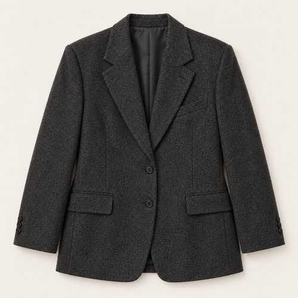
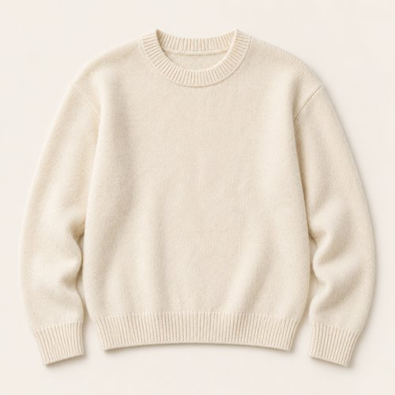
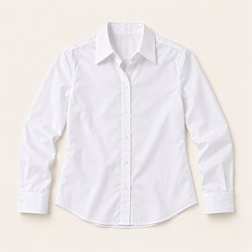
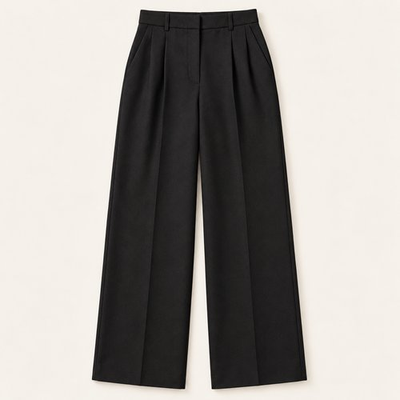
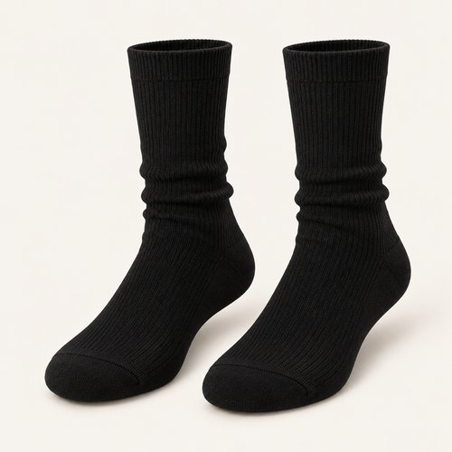
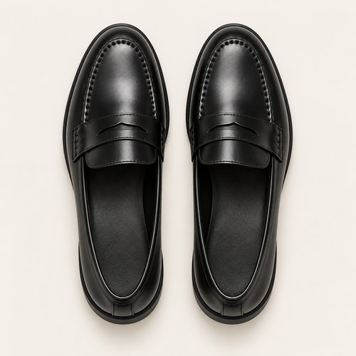
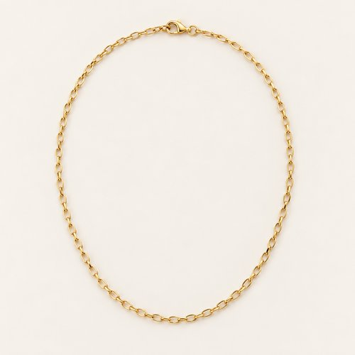
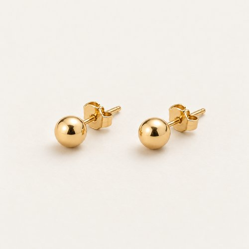

# CREAM BETWEEN CHARCOAL

| 언어 | 타이틀 |
| --- | --- |
| 한국어 | 크림 비트윈 차콜 |
| English | CREAM BETWEEN CHARCOAL |
| Deutsch | CREME ZWISCHEN ANTHRAZIT |

## 세트 정보

- Sunny / Chilly / Female / 35+ / Day / Minimal / 11
- 기존 앱 룩 ID: `bd15-11-minimal-f` - 매핑 시 유지
- 에디토리얼 1장 + 제품별 8장
- 정확한 기온·체감온도 수치: 확인되지 않음. Chilly는 원본 폴더 기준.
- 앱 매핑: pending. 사용자 요청에 따른 제품 제작·GitHub 업로드.

## Editorial

기존 `../11-minimal.jpg`의 앱용 압축 사본. 원본 경로 유지.

## How to wear

### 한국어

차콜과 블랙 사이, 크림과 화이트의 얇은 틈.

차콜 재킷 안에 크림 니트와 화이트 셔츠를 겹쳐요. 칼라와 커프, 밑단에서 셔츠를 조금씩 보여주고 블랙 팬츠·삭스·로퍼로 아래를 길게 연결해요.

### English

Cream and white between charcoal and black.

Layer cream knit and a white shirt beneath charcoal tailoring. Reveal small edges of collar, cuff and hem, then continue black trousers into black socks and loafers.

### Deutsch

Creme und Weiß zwischen Anthrazit und Schwarz.

Schichte cremefarbenen Strick und ein weißes Hemd unter einen anthrazitfarbenen Blazer. Zeige kleine Partien von Kragen, Manschetten und Saum und verbinde schwarze Hose, Socken und Loafer.

## The pieces

| 파일 | 한국어 | English | Deutsch |
| --- | --- | --- | --- |
| [01-outer](products/01-outer.jpg) | 차콜 테일러드 재킷 | Charcoal Tailored Jacket | Anthrazitfarbener Blazer |
| [02-top](products/02-top.jpg) | 크림 크루넥 니트 | Cream Crew-Neck Knit | Cremefarbener Rundhalspullover |
| [03-under](products/03-under.jpg) | 화이트 레이어 셔츠 | White Layering Shirt | Weißes Hemd |
| [04-bottom](products/04-bottom.jpg) | 블랙 플리츠 팬츠 | Black Pleated Trousers | Schwarze Bundfaltenhose |
| [05-socks](products/05-socks.jpg) | 블랙 리브 삭스 | Black Rib Socks | Schwarze Rippensocken |
| [06-shoes](products/06-shoes.jpg) | 블랙 페니 로퍼 | Black Penny Loafers | Schwarze Pennyloafer |
| [07-jewelry](products/07-jewelry.jpg) | 골드 톤 체인 네크리스 | Gold-Tone Chain Necklace | Goldfarbene Gliederkette |
| [08-earrings](products/08-earrings.jpg) | 미니 골드 스터드 | Mini Gold Studs | Kleine goldfarbene Ohrstecker |

### 01-outer · Charcoal Tailored Jacket

- KO: 앞을 열어 안쪽 레이어가 보이게 입어요. 소매와 밑단의 볼륨을 자연스럽게 남겨주세요.
- EN: Wear it open to reveal the inner layers, keeping the natural volume of sleeves and hem.
- DE: Trage die Jacke offen, damit die inneren Lagen sichtbar bleiben, und lasse Ärmeln und Saum ihr natürliches Volumen.
- 복원 구분: `visible-item-reconstructed`

### 02-top · Cream Crew-Neck Knit

- KO: 아우터 안에서 니트의 표면을 보여줘요. 밑단을 정돈해 와이드 하의의 여유를 살려요.
- EN: Show the knit texture beneath the jacket and keep the hem neat above the wide trousers.
- DE: Zeige die Strickstruktur unter der Jacke und ordne den Saum über der weiten Hose.
- 복원 구분: `partially-visible-reconstructed`

### 03-under · White Layering Shirt

- KO: 니트 아래에 겹쳐 입고 칼라와 커프만 조금 드러내요. 몸판은 겉으로 부풀지 않게 정리해요.
- EN: Layer beneath the knit, showing a little collar and cuff while keeping the body smooth.
- DE: Trage das Hemd unter dem Strick und zeige etwas Kragen und Manschetten, während der Rumpf glatt bleibt.
- 복원 구분: `partially-visible-reconstructed`

### 04-bottom · Black Pleated Trousers

- KO: 넉넉한 통을 접거나 조이지 않고 자연스럽게 떨어뜨려요. 상의 밑단을 정돈해 하의의 실루엣을 드러내요.
- EN: Let the generous legs fall naturally and keep the top hem neat so the trouser shape stays visible.
- DE: Lasse die weiten Beine natürlich fallen und ordne das Oberteil, damit die Form der Hose sichtbar bleibt.
- 복원 구분: `partially-visible-reconstructed`

### 05-socks · Black Rib Socks

- KO: 팬츠와 신발 사이에 리브 조직을 짧게 드러내요. 발목에 과하게 뭉치지 않게 정리해요.
- EN: Show a short section of ribbing between trousers and shoes without excessive bunching.
- DE: Zeige zwischen Hose und Schuhen etwas Rippstruktur, ohne die Socken stark zu stauchen.
- 복원 구분: `partially-visible-reconstructed`

### 06-shoes · Black Penny Loafers

- KO: 와이드 하의 아래 앞코와 솔이 드러나게 밑단 길이를 정돈해요.
- EN: Set the trouser length so the toe and sole remain visible beneath the wide leg.
- DE: Wähle die Hosenlänge so, dass Spitze und Sohle unter dem weiten Bein sichtbar bleiben.
- 복원 구분: `partially-visible-reconstructed`

### 07-jewelry · Gold-Tone Chain Necklace

- KO: 펜던트 없는 가는 체인을 크루넥 위에 짧게 걸쳐요. 셔츠 칼라와 겹치지 않게 위치를 정리해요.
- EN: Wear the fine chain without a pendant just above the crew neck, keeping it clear of the shirt collar.
- DE: Trage die feine Kette ohne Anhänger kurz über dem Rundhals und halte Abstand zum Hemdkragen.
- 복원 구분: `partially-visible-reconstructed`

### 08-earrings · Mini Gold Studs

- KO: 작은 골드 톤 스터드로 마무리해요. 목걸이와 톤을 맞추고 크기는 작게 유지해요.
- EN: Finish with tiny gold-tone studs, matching the necklace tone and keeping the scale small.
- DE: Ergänze kleine goldfarbene Ohrstecker im Ton der Halskette.
- 복원 구분: `partially-visible-reconstructed`

## 제작·검수·인수인계

- AI 스타일링 콘셉트 이미지. 실제 판매 상품이나 확인된 브랜드를 나타내지 않음.
- 가려진 뒷면·이너 몸판·허리·신발 반대쪽·주얼리 잠금 장치는 추정 복원.
- 소재 명칭은 외관 묘사. 실제 소재 혼용률·금속 성분·성능·가격은 확인되지 않음.
- 식음료·식기·식료품·종이봉투는 장면 소품으로 제외.
- 아이템 1종당 개별 파일. 신발·양말·귀걸이 한 쌍은 한 아이템.
- 에디토리얼 1024×1536 JPG ≤300KB. 제품별 500×500 JPG ≤50KB.
- 낮은 신발은 나란히 정돈한 수직 탑뷰. 앵클부츠는 두 짝을 세운 3/4 구도.
- 날씨 수치는 앱 카피에서 제외하고 메타데이터와 분리.
- 기존 ID와 기존 에디토리얼 경로 보존. 앱 연결 작업은 pending.
