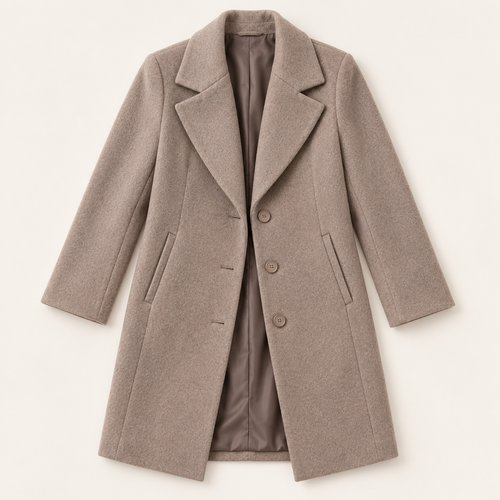
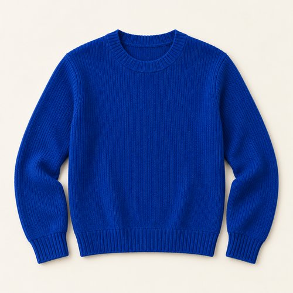
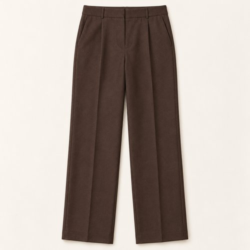
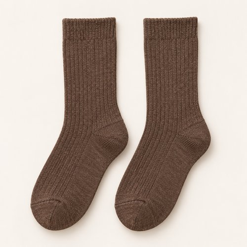
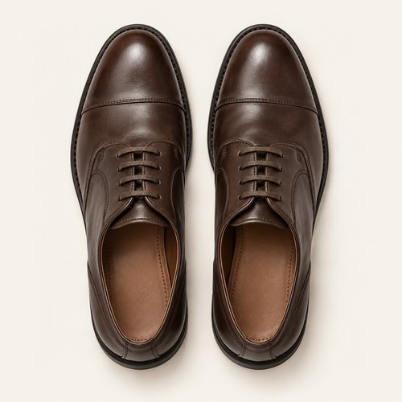
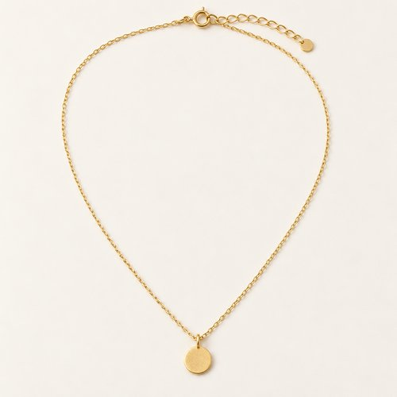
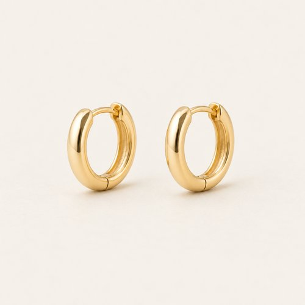

# COBALT, QUIETLY

| 언어 | 타이틀 |
| --- | --- |
| 한국어 | 코발트 콰이어틀리 |
| English | COBALT, QUIETLY |
| Deutsch | KOBALTBLAU, GANZ RUHIG |

## 세트 정보

- Sunny / Chilly / Female / 35+ / Day / Minimal / 12
- 기존 앱 룩 ID: `bd15-12-minimal-f` - 매핑 시 유지
- 에디토리얼 1장 + 제품별 7장
- 정확한 기온·체감온도 수치: 확인되지 않음. Chilly는 원본 폴더 기준.
- 앱 매핑: pending. 사용자 요청에 따른 제품 제작·GitHub 업로드.

## Editorial

기존 `../12-minimal.jpg`의 앱용 압축 사본. 원본 경로 유지.

## How to wear

### 한국어

토프와 초콜릿 사이에 코발트 한 면.

토프 코트를 열어 코발트 니트를 선명하게 보여줘요. 초콜릿 팬츠와 브라운 삭스, 다크 브라운 레이스업을 비슷한 농도로 맞추고 작은 코인 펜던트로 마무리해요.

### English

One panel of cobalt between taupe and chocolate.

Open the taupe coat to show a clear panel of cobalt knit. Keep chocolate trousers, brown socks and dark lace-ups close in tone, finishing with a small coin pendant.

### Deutsch

Eine Fläche Kobaltblau zwischen Taupe und Schokoladenbraun.

Öffne den taupefarbenen Mantel über kräftigem Kobaltblau. Halte schokoladenbraune Hose, braune Socken und dunkle Schnürschuhe tonal nah beieinander und ergänze einen kleinen Münzanhänger.

## The pieces

| 파일 | 한국어 | English | Deutsch |
| --- | --- | --- | --- |
| [01-outer](products/01-outer.jpg) | 토프 테일러드 코트 | Taupe Tailored Coat | Taupefarbener Mantel |
| [02-top](products/02-top.jpg) | 코발트 리브 니트 | Cobalt Rib Knit | Kobaltblauer Rippstrickpullover |
| [03-bottom](products/03-bottom.jpg) | 초콜릿 스트레이트 팬츠 | Chocolate Straight-Leg Trousers | Schokoladenbraune gerade Hose |
| [04-socks](products/04-socks.jpg) | 브라운 리브 삭스 | Brown Rib Socks | Braune Rippensocken |
| [05-shoes](products/05-shoes.jpg) | 다크 브라운 레이스업 | Dark Brown Lace-Ups | Dunkelbraune Schnürschuhe |
| [06-jewelry](products/06-jewelry.jpg) | 골드 톤 코인 네크리스 | Gold-Tone Coin Necklace | Goldfarbene Münzkette |
| [07-earrings](products/07-earrings.jpg) | 미니 골드 이어링 | Mini Gold Earrings | Kleine goldfarbene Ohrringe |

### 01-outer · Taupe Tailored Coat

- KO: 앞을 열어 안쪽 레이어가 보이게 입어요. 소매와 밑단의 볼륨을 자연스럽게 남겨주세요.
- EN: Wear it open to reveal the inner layers, keeping the natural volume of sleeves and hem.
- DE: Trage die Jacke offen, damit die inneren Lagen sichtbar bleiben, und lasse Ärmeln und Saum ihr natürliches Volumen.
- 복원 구분: `visible-item-reconstructed`

### 02-top · Cobalt Rib Knit

- KO: 코발트 니트를 단독 컬러 포인트로 둬요. 코트를 열어 앞면의 선명한 블루가 드러나게 해요.
- EN: Use cobalt knit as the single bold colour and open the coat to reveal its blue front.
- DE: Setze mit Kobaltblau den einzigen kräftigen Farbakzent und öffne den Mantel darüber.
- 복원 구분: `partially-visible-reconstructed`

### 03-bottom · Chocolate Straight-Leg Trousers

- KO: 넉넉한 통을 접거나 조이지 않고 자연스럽게 떨어뜨려요. 상의 밑단을 정돈해 하의의 실루엣을 드러내요.
- EN: Let the generous legs fall naturally and keep the top hem neat so the trouser shape stays visible.
- DE: Lasse die weiten Beine natürlich fallen und ordne das Oberteil, damit die Form der Hose sichtbar bleibt.
- 복원 구분: `partially-visible-reconstructed`

### 04-socks · Brown Rib Socks

- KO: 팬츠와 신발 사이에 리브 조직을 짧게 드러내요. 발목에 과하게 뭉치지 않게 정리해요.
- EN: Show a short section of ribbing between trousers and shoes without excessive bunching.
- DE: Zeige zwischen Hose und Schuhen etwas Rippstruktur, ohne die Socken stark zu stauchen.
- 복원 구분: `partially-visible-reconstructed`

### 05-shoes · Dark Brown Lace-Ups

- KO: 팬츠와 양말의 브라운을 레이스업까지 이어줘요. 끈은 단정하게 묶어 앞코의 매끈함을 살려요.
- EN: Continue the brown of trousers and socks into lace-ups, tying them neatly to keep the toe clean.
- DE: Führe die Brauntöne von Hose und Socken in Schnürschuhen fort und binde die Senkel ordentlich.
- 복원 구분: `partially-visible-reconstructed`

### 06-jewelry · Gold-Tone Coin Necklace

- KO: 니트 위로 작은 펜던트만 드러내요. 가는 체인으로 목선의 레이어를 가볍게 이어줘요.
- EN: Let the small pendant sit over the knit, keeping the neckline light with a fine chain.
- DE: Lasse den kleinen Anhänger über dem Strick liegen und halte den Ausschnitt mit einer feinen Kette leicht.
- 복원 구분: `partially-visible-reconstructed`

### 07-earrings · Mini Gold Earrings

- KO: 작은 후프로 얼굴 가까이에 은은한 포인트를 더해요. 목걸이와 비슷한 금속 톤으로 정리해요.
- EN: Add a subtle accent near the face with small earrings, keeping the metal tone coordinated.
- DE: Setze mit kleinen Ohrringen einen dezenten Akzent am Gesicht und stimme den Metallton ab.
- 복원 구분: `partially-visible-reconstructed`

## 제작·검수·인수인계

- AI 스타일링 콘셉트 이미지. 실제 판매 상품이나 확인된 브랜드를 나타내지 않음.
- 가려진 뒷면·이너 몸판·허리·신발 반대쪽·주얼리 잠금 장치는 추정 복원.
- 소재 명칭은 외관 묘사. 실제 소재 혼용률·금속 성분·성능·가격은 확인되지 않음.
- 식음료·식기·식료품·종이봉투는 장면 소품으로 제외.
- 아이템 1종당 개별 파일. 신발·양말·귀걸이 한 쌍은 한 아이템.
- 에디토리얼 1024×1536 JPG ≤300KB. 제품별 500×500 JPG ≤50KB.
- 낮은 신발은 나란히 정돈한 수직 탑뷰. 앵클부츠는 두 짝을 세운 3/4 구도.
- 날씨 수치는 앱 카피에서 제외하고 메타데이터와 분리.
- 기존 ID와 기존 에디토리얼 경로 보존. 앱 연결 작업은 pending.
