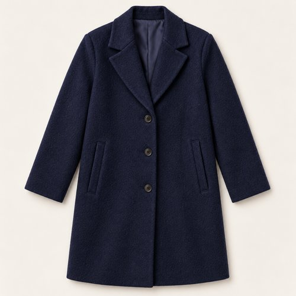
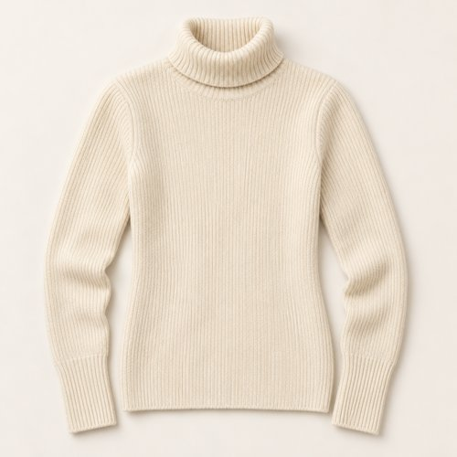
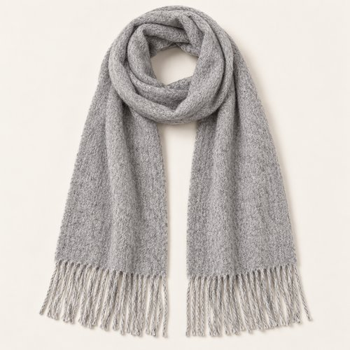
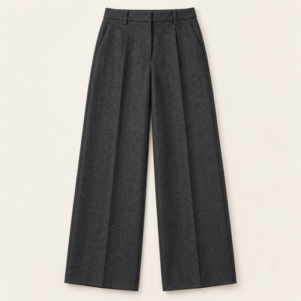
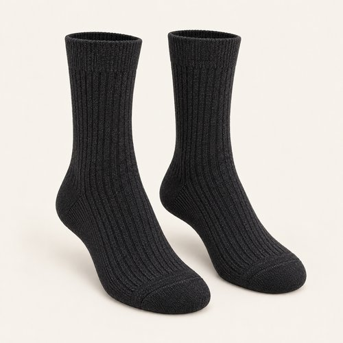
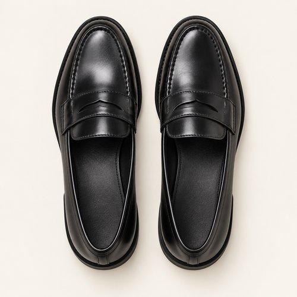
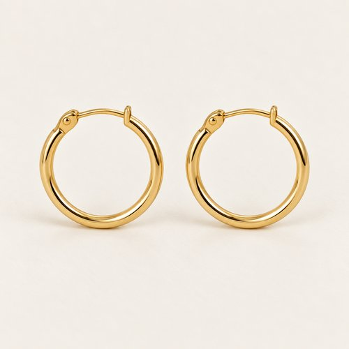
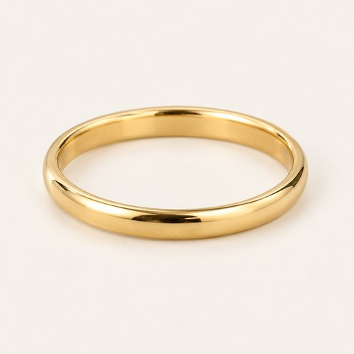
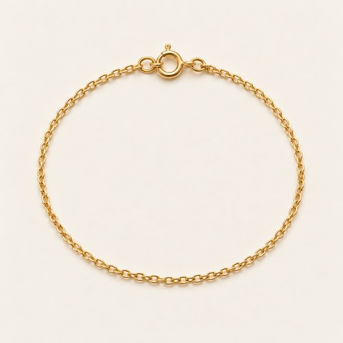
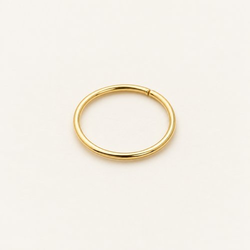

# NAVY IN SOFT FOCUS

| 언어 | 타이틀 |
| --- | --- |
| 한국어 | 네이비 인 소프트 포커스 |
| English | NAVY IN SOFT FOCUS |
| Deutsch | MARINEBLAU, SANFT GEZEICHNET |

## 세트 정보

- Sunny / Chilly / Female / 35+ / Day / Minimal / 13
- 기존 앱 룩 ID: `bd15-13-minimal-f` - 매핑 시 유지
- 에디토리얼 1장 + 제품별 10장
- 정확한 기온·체감온도 수치: 확인되지 않음. Chilly는 원본 폴더 기준.
- 앱 매핑: pending. 사용자 요청에 따른 제품 제작·GitHub 업로드.

## Editorial

기존 `../13-minimal.jpg`의 앱용 압축 사본. 원본 경로 유지.

## How to wear

### 한국어

네이비, 그레이, 아이보리. 색보다 부드러운 표면.

네이비 코트 안에 아이보리 터틀넥을 넣고 그레이 머플러를 길게 떨어뜨려요. 차콜 와이드 팬츠와 어두운 삭스·로퍼로 흐름을 이어가고, 얇은 골드 톤 주얼리만 더해요.

### English

Navy, grey and ivory. Texture leads.

Wear an ivory turtleneck beneath navy and let a grey scarf fall long. Charcoal wide-leg trousers flow into dark socks and loafers; fine gold-tone jewellery keeps the accents small.

### Deutsch

Marineblau, Grau und Elfenbein. Die Textur gibt den Ton an.

Trage einen elfenbeinfarbenen Rollkragen unter Marineblau und lasse den grauen Schal lang fallen. Eine weite anthrazitfarbene Hose geht in dunkle Socken und Loafer über; feiner goldfarbener Schmuck setzt kleine Akzente.

## The pieces

| 파일 | 한국어 | English | Deutsch |
| --- | --- | --- | --- |
| [01-outer](products/01-outer.jpg) | 네이비 테일러드 코트 | Navy Tailored Coat | Marineblauer Mantel |
| [02-top](products/02-top.jpg) | 아이보리 터틀넥 니트 | Ivory Turtleneck Knit | Elfenbeinfarbener Rollkragenpullover |
| [03-scarf](products/03-scarf.jpg) | 그레이 프린지 머플러 | Grey Fringed Scarf | Grauer Fransenschal |
| [04-bottom](products/04-bottom.jpg) | 차콜 와이드 팬츠 | Charcoal Wide-Leg Trousers | Anthrazitfarbene weite Hose |
| [05-socks](products/05-socks.jpg) | 차콜 리브 삭스 | Charcoal Rib Socks | Anthrazitfarbene Rippensocken |
| [06-shoes](products/06-shoes.jpg) | 블랙 페니 로퍼 | Black Penny Loafers | Schwarze Pennyloafer |
| [07-earrings](products/07-earrings.jpg) | 골드 톤 슬림 후프 | Gold-Tone Slim Hoops | Schmale goldfarbene Creolen |
| [08-ring](products/08-ring.jpg) | 골드 톤 슬림 링 | Gold-Tone Slim Ring | Schmaler goldfarbener Ring |
| [09-bracelet](products/09-bracelet.jpg) | 골드 톤 체인 브레이슬릿 | Gold-Tone Chain Bracelet | Goldfarbenes Kettenarmband |
| [10-nose-ring](products/10-nose-ring.jpg) | 골드 톤 미니 노즈 링 | Gold-Tone Mini Nose Ring | Kleiner goldfarbener Nasenring |

### 01-outer · Navy Tailored Coat

- KO: 앞을 열어 안쪽 레이어가 보이게 입어요. 소매와 밑단의 볼륨을 자연스럽게 남겨주세요.
- EN: Wear it open to reveal the inner layers, keeping the natural volume of sleeves and hem.
- DE: Trage die Jacke offen, damit die inneren Lagen sichtbar bleiben, und lasse Ärmeln und Saum ihr natürliches Volumen.
- 복원 구분: `visible-item-reconstructed`

### 02-top · Ivory Turtleneck Knit

- KO: 터틀넥의 접힌 칼라를 정돈하고 머플러를 바깥으로 둘러요. 아이보리를 목과 커프에서 보여줘요.
- EN: Set the folded turtleneck collar neatly beneath the scarf, showing ivory at neck and cuffs.
- DE: Ordne den umgeschlagenen Rollkragen unter dem Schal und zeige Elfenbein an Hals und Bündchen.
- 복원 구분: `partially-visible-reconstructed`

### 03-scarf · Grey Fringed Scarf

- KO: 목에 한 번 두르고 양 끝을 길게 늘어뜨려요. 프린지가 하의 위로 자연스럽게 이어지게 해요.
- EN: Wrap once around the neck and let the ends fall long, with the fringe resting over the trousers.
- DE: Lege den Schal einmal um den Hals und lasse die Enden lang über die Hose fallen.
- 복원 구분: `partially-visible-reconstructed`

### 04-bottom · Charcoal Wide-Leg Trousers

- KO: 넉넉한 통을 접거나 조이지 않고 자연스럽게 떨어뜨려요. 상의 밑단을 정돈해 하의의 실루엣을 드러내요.
- EN: Let the generous legs fall naturally and keep the top hem neat so the trouser shape stays visible.
- DE: Lasse die weiten Beine natürlich fallen und ordne das Oberteil, damit die Form der Hose sichtbar bleibt.
- 복원 구분: `partially-visible-reconstructed`

### 05-socks · Charcoal Rib Socks

- KO: 팬츠와 신발 사이에 리브 조직을 짧게 드러내요. 발목에 과하게 뭉치지 않게 정리해요.
- EN: Show a short section of ribbing between trousers and shoes without excessive bunching.
- DE: Zeige zwischen Hose und Schuhen etwas Rippstruktur, ohne die Socken stark zu stauchen.
- 복원 구분: `partially-visible-reconstructed`

### 06-shoes · Black Penny Loafers

- KO: 와이드 하의 아래 앞코와 솔이 드러나게 밑단 길이를 정돈해요.
- EN: Set the trouser length so the toe and sole remain visible beneath the wide leg.
- DE: Wähle die Hosenlänge so, dass Spitze und Sohle unter dem weiten Bein sichtbar bleiben.
- 복원 구분: `partially-visible-reconstructed`

### 07-earrings · Gold-Tone Slim Hoops

- KO: 작은 후프로 얼굴 가까이에 은은한 포인트를 더해요. 목걸이와 비슷한 금속 톤으로 정리해요.
- EN: Add a subtle accent near the face with small earrings, keeping the metal tone coordinated.
- DE: Setze mit kleinen Ohrringen einen dezenten Akzent am Gesicht und stimme den Metallton ab.
- 복원 구분: `partially-visible-reconstructed`

### 08-ring · Gold-Tone Slim Ring

- KO: 얇은 링 하나로 손의 디테일을 더해요. 다른 액세서리와 골드 톤을 맞춰요.
- EN: Add a single slim ring and coordinate its gold tone with the other accessories.
- DE: Ergänze einen einzelnen schmalen Ring und stimme seinen Goldton auf die übrigen Accessoires ab.
- 복원 구분: `partially-visible-reconstructed`

### 09-bracelet · Gold-Tone Chain Bracelet

- KO: 소매 끝에 가는 골드 톤 체인 팔찌를 살짝 보여줘요. 다른 주얼리와 톤을 맞춰요.
- EN: Reveal a fine gold-tone wrist chain at the cuff, matching the other jewellery.
- DE: Zeige am Ärmelabschluss eine feine goldfarbene Armbandkette im Ton des übrigen Schmucks.
- 복원 구분: `partially-visible-reconstructed`

### 10-nose-ring · Gold-Tone Mini Nose Ring

- KO: 작은 노즈 링은 다른 주얼리와 같은 골드 톤으로 맞춰요. 크기를 키우거나 장식을 더하지 않아요.
- EN: Keep the tiny nose hoop in the same gold tone as the other jewellery, without enlarging or adding ornament.
- DE: Halte den kleinen Nasenring im Goldton des übrigen Schmucks, ohne ihn zu vergrößern oder zu verzieren.
- 복원 구분: `partially-visible-reconstructed`

## 제작·검수·인수인계

- AI 스타일링 콘셉트 이미지. 실제 판매 상품이나 확인된 브랜드를 나타내지 않음.
- 가려진 뒷면·이너 몸판·허리·신발 반대쪽·주얼리 잠금 장치는 추정 복원.
- 소재 명칭은 외관 묘사. 실제 소재 혼용률·금속 성분·성능·가격은 확인되지 않음.
- 식음료·식기·식료품·종이봉투는 장면 소품으로 제외.
- 아이템 1종당 개별 파일. 신발·양말·귀걸이 한 쌍은 한 아이템.
- 에디토리얼 1024×1536 JPG ≤300KB. 제품별 500×500 JPG ≤50KB.
- 낮은 신발은 나란히 정돈한 수직 탑뷰. 앵클부츠는 두 짝을 세운 3/4 구도.
- 날씨 수치는 앱 카피에서 제외하고 메타데이터와 분리.
- 기존 ID와 기존 에디토리얼 경로 보존. 앱 연결 작업은 pending.
- 노즈 링·손가락 링·손목 체인은 원본의 작은 디테일을 바탕으로 해석했으며, 가려진 구조는 추정. 잘린 로퍼는 보이는 부분으로 한 쌍을 복원.
