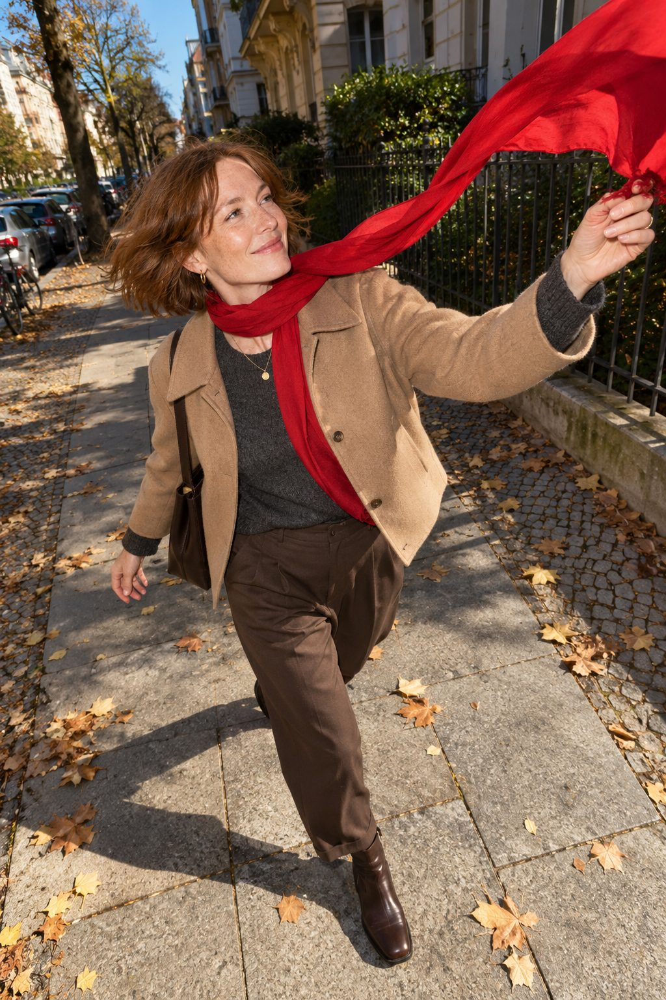
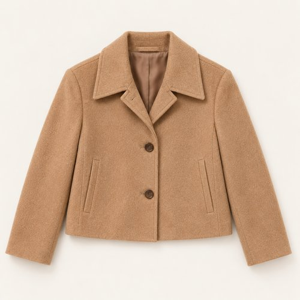
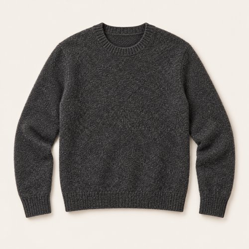
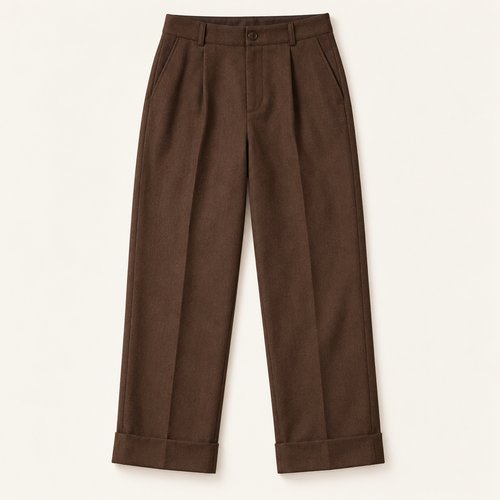
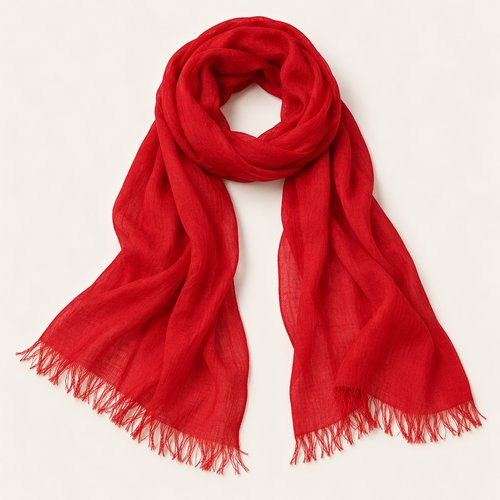
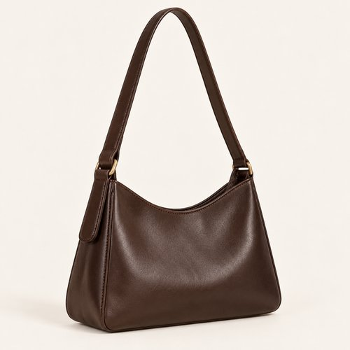
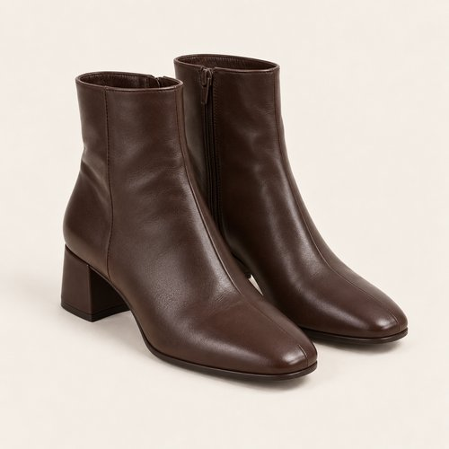
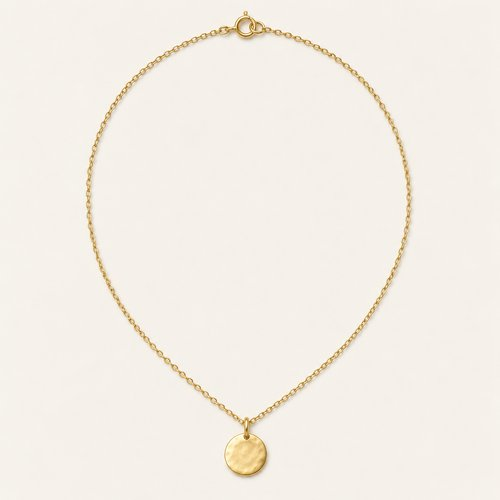
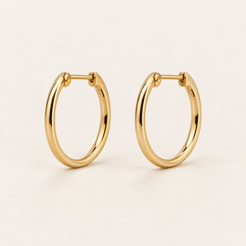

# A LINE OF RED

| 언어 | 타이틀 |
| --- | --- |
| 한국어 | 어 라인 오브 레드 |
| English | A LINE OF RED |
| Deutsch | EINE LINIE IN ROT |

## 세트 정보

- Sunny / Chilly / Female / 35+ / Day / Minimal / 14
- 기존 앱 룩 ID: `bd15-14-minimal-f` - 매핑 시 유지
- 에디토리얼 1장 + 제품별 8장
- 정확한 기온·체감온도 수치: 확인되지 않음. Chilly는 원본 폴더 기준.
- 앱 매핑: pending. 사용자 요청에 따른 제품 제작·GitHub 업로드.

## Editorial

기존 `../14-minimal.jpg`의 앱용 압축 사본. 원본 경로 유지.

## How to wear

### 한국어

카멜과 브라운 위로, 길게 이어지는 레드.

카멜 크롭 재킷과 브라운 턴업 팬츠를 차콜 니트로 연결해요. 얇은 레드 스카프를 길게 두르고 다크 브라운 숄더백과 앵클부츠로 톤을 정리해요.

### English

A long line of red over camel and brown.

Link a cropped camel jacket and brown turn-up trousers with charcoal knit. Let a lightweight red scarf fall long, then ground the palette with a dark brown bag and ankle boots.

### Deutsch

Eine lange rote Linie über Camel und Braun.

Verbinde eine kurze camelfarbene Jacke und braune Umschlaghosen durch anthrazitfarbenen Strick. Lasse einen leichten roten Schal lang fallen und ergänze eine dunkelbraune Tasche sowie Ankle-Boots.

## The pieces

| 파일 | 한국어 | English | Deutsch |
| --- | --- | --- | --- |
| [01-outer](products/01-outer.jpg) | 카멜 크롭 재킷 | Camel Cropped Jacket | Kurze camelfarbene Jacke |
| [02-top](products/02-top.jpg) | 차콜 멜란지 니트 | Charcoal Mélange Knit | Anthrazitfarbener melierter Pullover |
| [03-bottom](products/03-bottom.jpg) | 브라운 턴업 팬츠 | Brown Turn-Up Trousers | Braune Hose mit Umschlag |
| [04-scarf](products/04-scarf.jpg) | 레드 라이트 스카프 | Red Lightweight Scarf | Leichter roter Schal |
| [05-bag](products/05-bag.jpg) | 다크 브라운 숄더백 | Dark Brown Shoulder Bag | Dunkelbraune Schultertasche |
| [06-shoes](products/06-shoes.jpg) | 브라운 앵클부츠 | Brown Ankle Boots | Braune Ankle-Boots |
| [07-jewelry](products/07-jewelry.jpg) | 골드 톤 코인 네크리스 | Gold-Tone Coin Necklace | Goldfarbene Münzkette |
| [08-earrings](products/08-earrings.jpg) | 미니 골드 후프 | Mini Gold Hoops | Kleine goldfarbene Creolen |

### 01-outer · Camel Cropped Jacket

- KO: 앞을 열어 안쪽 레이어가 보이게 입어요. 소매와 밑단의 볼륨을 자연스럽게 남겨주세요.
- EN: Wear it open to reveal the inner layers, keeping the natural volume of sleeves and hem.
- DE: Trage die Jacke offen, damit die inneren Lagen sichtbar bleiben, und lasse Ärmeln und Saum ihr natürliches Volumen.
- 복원 구분: `visible-item-reconstructed`

### 02-top · Charcoal Mélange Knit

- KO: 아우터 안에서 니트의 표면을 보여줘요. 밑단을 정돈해 와이드 하의의 여유를 살려요.
- EN: Show the knit texture beneath the jacket and keep the hem neat above the wide trousers.
- DE: Zeige die Strickstruktur unter der Jacke und ordne den Saum über der weiten Hose.
- 복원 구분: `partially-visible-reconstructed`

### 03-bottom · Brown Turn-Up Trousers

- KO: 넉넉한 통을 접거나 조이지 않고 자연스럽게 떨어뜨려요. 상의 밑단을 정돈해 하의의 실루엣을 드러내요.
- EN: Let the generous legs fall naturally and keep the top hem neat so the trouser shape stays visible.
- DE: Lasse die weiten Beine natürlich fallen und ordne das Oberteil, damit die Form der Hose sichtbar bleibt.
- 복원 구분: `partially-visible-reconstructed`

### 04-scarf · Red Lightweight Scarf

- KO: 얇은 레드 스카프를 목에 한 번 두르고 끝을 길게 남겨요. 두껍게 말기보다 가벼운 선으로 보여줘요.
- EN: Wrap the lightweight red scarf once, leaving long ends rather than building a bulky knot.
- DE: Lege den leichten roten Schal einmal um den Hals und lasse lange Enden statt eines dicken Knotens stehen.
- 복원 구분: `partially-visible-reconstructed`

### 05-bag · Dark Brown Shoulder Bag

- KO: 몸 가까이 걸쳐 실루엣을 간결하게 정리해요. 스트랩은 겉옷 위에서 자연스럽게 이어줘요.
- EN: Carry close to the body for a clean silhouette, letting the strap sit naturally over the outer layer.
- DE: Trage die Tasche nah am Körper und lasse den Riemen natürlich über der äußeren Lage liegen.
- 복원 구분: `partially-visible-reconstructed`

### 06-shoes · Brown Ankle Boots

- KO: 턴업 밑단을 부츠 샤프트 위에 자연스럽게 두어요. 팬츠와 부츠의 짙은 브라운을 연결해요.
- EN: Let the turn-up hem sit naturally above the boot shaft, linking the dark browns.
- DE: Lasse den Umschlag natürlich über dem Stiefelschaft sitzen und verbinde die dunklen Brauntöne.
- 복원 구분: `partially-visible-reconstructed`

### 07-jewelry · Gold-Tone Coin Necklace

- KO: 니트 위로 작은 펜던트만 드러내요. 가는 체인으로 목선의 레이어를 가볍게 이어줘요.
- EN: Let the small pendant sit over the knit, keeping the neckline light with a fine chain.
- DE: Lasse den kleinen Anhänger über dem Strick liegen und halte den Ausschnitt mit einer feinen Kette leicht.
- 복원 구분: `partially-visible-reconstructed`

### 08-earrings · Mini Gold Hoops

- KO: 작은 후프로 얼굴 가까이에 은은한 포인트를 더해요. 목걸이와 비슷한 금속 톤으로 정리해요.
- EN: Add a subtle accent near the face with small earrings, keeping the metal tone coordinated.
- DE: Setze mit kleinen Ohrringen einen dezenten Akzent am Gesicht und stimme den Metallton ab.
- 복원 구분: `partially-visible-reconstructed`

## 제작·검수·인수인계

- AI 스타일링 콘셉트 이미지. 실제 판매 상품이나 확인된 브랜드를 나타내지 않음.
- 가려진 뒷면·이너 몸판·허리·신발 반대쪽·주얼리 잠금 장치는 추정 복원.
- 소재 명칭은 외관 묘사. 실제 소재 혼용률·금속 성분·성능·가격은 확인되지 않음.
- 식음료·식기·식료품·종이봉투는 장면 소품으로 제외.
- 아이템 1종당 개별 파일. 신발·양말·귀걸이 한 쌍은 한 아이템.
- 에디토리얼 1024×1536 JPG ≤300KB. 제품별 500×500 JPG ≤50KB.
- 낮은 신발은 나란히 정돈한 수직 탑뷰. 앵클부츠는 두 짝을 세운 3/4 구도.
- 날씨 수치는 앱 카피에서 제외하고 메타데이터와 분리.
- 기존 ID와 기존 에디토리얼 경로 보존. 앱 연결 작업은 pending.
- 양말은 부츠 안에 가려져 별도 생성하지 않음.
