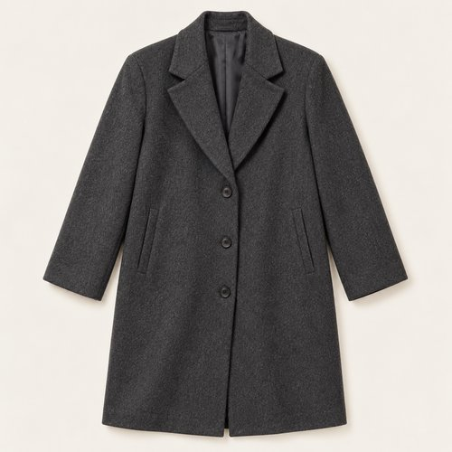
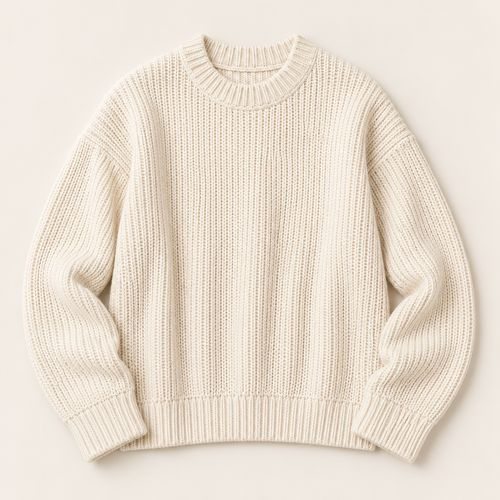
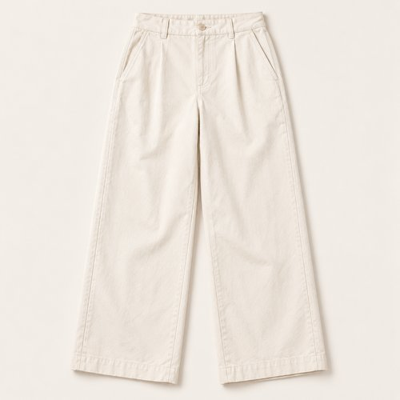
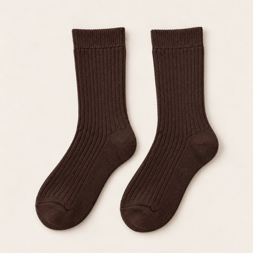
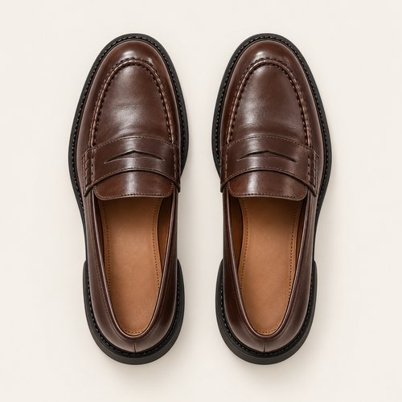
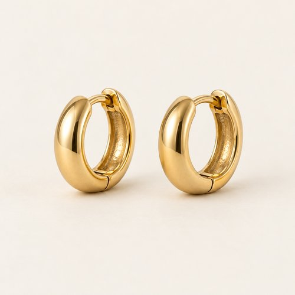
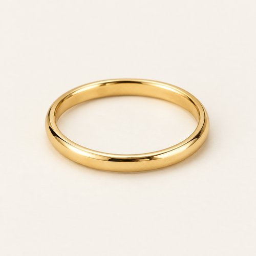

# CREAM, WITH COFFEE

| 언어 | 타이틀 |
| --- | --- |
| 한국어 | 크림 위드 커피 |
| English | CREAM, WITH COFFEE |
| Deutsch | CREME MIT KAFFEEBRAUN |

## 세트 정보

- Sunny / Chilly / Female / 35+ / Day / Minimal / 15
- 기존 앱 룩 ID: `bd15-15-minimal-f` - 매핑 시 유지
- 에디토리얼 1장 + 제품별 7장
- 정확한 기온·체감온도 수치: 확인되지 않음. Chilly는 원본 폴더 기준.
- 앱 매핑: pending. 사용자 요청에 따른 제품 제작·GitHub 업로드.

## Editorial

기존 `../15-minimal.jpg`의 앱용 압축 사본. 원본 경로 유지.

## How to wear

### 한국어

크림 레이어에 코코아와 에스프레소 한 톤.

차콜 코트 아래 아이보리 니트와 오프화이트 팬츠를 이어 밝은 면을 만들어요. 코코아 삭스와 에스프레소 로퍼로 발끝을 짙게 정리하고 작은 후프와 얇은 링만 더해요.

### English

Cream layers, finished in cocoa and espresso.

Create a pale panel with ivory knit and off-white trousers beneath a charcoal coat. Cocoa socks and espresso loafers deepen the finish, with small hoops and one slim ring.

### Deutsch

Cremefarbene Lagen, abgerundet mit Kakao und Espresso.

Bilde mit elfenbeinfarbenem Strick und einer offwhitefarbenen Hose eine helle Fläche unter dem anthrazitfarbenen Mantel. Kakaobraune Socken und espressobraune Loafer setzen einen dunklen Abschluss, ergänzt durch kleine Creolen und einen schmalen Ring.

## The pieces

| 파일 | 한국어 | English | Deutsch |
| --- | --- | --- | --- |
| [01-outer](products/01-outer.jpg) | 차콜 테일러드 코트 | Charcoal Tailored Coat | Anthrazitfarbener Mantel |
| [02-top](products/02-top.jpg) | 아이보리 텍스처 니트 | Ivory Textured Knit | Elfenbeinfarbener Strukturpullover |
| [03-bottom](products/03-bottom.jpg) | 오프화이트 와이드 팬츠 | Off-White Wide-Leg Trousers | Offwhitefarbene weite Hose |
| [04-socks](products/04-socks.jpg) | 코코아 리브 삭스 | Cocoa Rib Socks | Kakaobraune Rippensocken |
| [05-shoes](products/05-shoes.jpg) | 에스프레소 페니 로퍼 | Espresso Penny Loafers | Espressobraune Pennyloafer |
| [06-earrings](products/06-earrings.jpg) | 미니 골드 허기 후프 | Mini Gold Huggie Hoops | Kleine goldfarbene Huggie-Creolen |
| [07-ring](products/07-ring.jpg) | 골드 톤 슬림 링 | Gold-Tone Slim Ring | Schmaler goldfarbener Ring |

### 01-outer · Charcoal Tailored Coat

- KO: 앞을 열어 안쪽 레이어가 보이게 입어요. 소매와 밑단의 볼륨을 자연스럽게 남겨주세요.
- EN: Wear it open to reveal the inner layers, keeping the natural volume of sleeves and hem.
- DE: Trage die Jacke offen, damit die inneren Lagen sichtbar bleiben, und lasse Ärmeln und Saum ihr natürliches Volumen.
- 복원 구분: `visible-item-reconstructed`

### 02-top · Ivory Textured Knit

- KO: 아우터 안에서 니트의 표면을 보여줘요. 밑단을 정돈해 와이드 하의의 여유를 살려요.
- EN: Show the knit texture beneath the jacket and keep the hem neat above the wide trousers.
- DE: Zeige die Strickstruktur unter der Jacke und ordne den Saum über der weiten Hose.
- 복원 구분: `partially-visible-reconstructed`

### 03-bottom · Off-White Wide-Leg Trousers

- KO: 니트와 비슷한 크림 톤으로 밝은 면을 이어줘요. 넉넉한 밑단 아래 브라운 삭스를 조금 드러내요.
- EN: Continue the cream of the knit through the trousers, revealing a little brown sock below the wide hem.
- DE: Führe den Cremeton des Pullovers in der Hose fort und zeige unter dem weiten Saum etwas braune Socke.
- 복원 구분: `partially-visible-reconstructed`

### 04-socks · Cocoa Rib Socks

- KO: 팬츠와 신발 사이에 리브 조직을 짧게 드러내요. 발목에 과하게 뭉치지 않게 정리해요.
- EN: Show a short section of ribbing between trousers and shoes without excessive bunching.
- DE: Zeige zwischen Hose und Schuhen etwas Rippstruktur, ohne die Socken stark zu stauchen.
- 복원 구분: `partially-visible-reconstructed`

### 05-shoes · Espresso Penny Loafers

- KO: 코코아 삭스와 에스프레소 로퍼를 짙은 한 톤으로 이어줘요. 밝은 팬츠와 대비되는 발끝이에요.
- EN: Link cocoa socks to espresso loafers for a dark finish against the pale trousers.
- DE: Verbinde kakaobraune Socken und espressobraune Loafer als dunklen Abschluss zur hellen Hose.
- 복원 구분: `partially-visible-reconstructed`

### 06-earrings · Mini Gold Huggie Hoops

- KO: 작은 후프로 얼굴 가까이에 은은한 포인트를 더해요. 목걸이와 비슷한 금속 톤으로 정리해요.
- EN: Add a subtle accent near the face with small earrings, keeping the metal tone coordinated.
- DE: Setze mit kleinen Ohrringen einen dezenten Akzent am Gesicht und stimme den Metallton ab.
- 복원 구분: `partially-visible-reconstructed`

### 07-ring · Gold-Tone Slim Ring

- KO: 얇은 링 하나로 손의 디테일을 더해요. 다른 액세서리와 골드 톤을 맞춰요.
- EN: Add a single slim ring and coordinate its gold tone with the other accessories.
- DE: Ergänze einen einzelnen schmalen Ring und stimme seinen Goldton auf die übrigen Accessoires ab.
- 복원 구분: `partially-visible-reconstructed`

## 제작·검수·인수인계

- AI 스타일링 콘셉트 이미지. 실제 판매 상품이나 확인된 브랜드를 나타내지 않음.
- 가려진 뒷면·이너 몸판·허리·신발 반대쪽·주얼리 잠금 장치는 추정 복원.
- 소재 명칭은 외관 묘사. 실제 소재 혼용률·금속 성분·성능·가격은 확인되지 않음.
- 식음료·식기·식료품·종이봉투는 장면 소품으로 제외.
- 아이템 1종당 개별 파일. 신발·양말·귀걸이 한 쌍은 한 아이템.
- 에디토리얼 1024×1536 JPG ≤300KB. 제품별 500×500 JPG ≤50KB.
- 낮은 신발은 나란히 정돈한 수직 탑뷰. 앵클부츠는 두 짝을 세운 3/4 구도.
- 날씨 수치는 앱 카피에서 제외하고 메타데이터와 분리.
- 기존 ID와 기존 에디토리얼 경로 보존. 앱 연결 작업은 pending.
